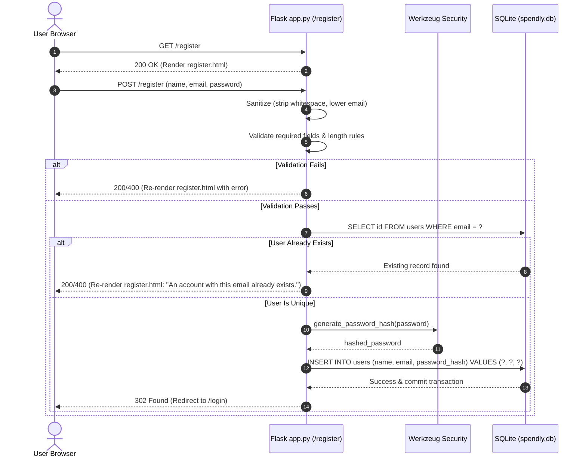

# Plan: 02 — User Registration

> **Spec Document:** `specs/02 Registration.md`  
> **Target Status:** Ready for Implementation  
> **Estimated Changes:** 1 file to modify (`expense-tracker/app.py`), 0 files to create, 0 new external dependencies.

---

## 1. Executive Summary

This plan provides a step-by-step engineering roadmap for implementing the **User Registration** feature in the Spendly personal finance application. 

Following the architecture defined in [`02 Registration.md`](file:///c:/Users/Siddhant/Downloads/expense-tracker/.anitigravity/specs/02%20Registration.md), this task transitions the `/register` endpoint from a static placeholder into a secure, production-grade onboarding workflow. It covers input sanitization, multi-stage validation, case-insensitive duplicate account detection, cryptographic password hashing via Werkzeug, parameterized SQLite persistence using [`get_db()`](file:///c:/Users/Siddhant/Downloads/expense-tracker/expense-tracker/database/db.py#L21-L26), error re-rendering with field preservation, and clean redirection to the login interface.

---

## 2. Architecture & Design Specification

### 2.1 Request Lifecycle Flow



---

### 2.2 Endpoint Specification

- **URI:** `/register`
- **Supported Methods:** `GET`, `POST`
- **View Function:** `register()` in `expense-tracker/app.py`
- **Form Action:** Matches action attribute `<form method="POST" action="/register">` in [`register.html`](file:///c:/Users/Siddhant/Downloads/expense-tracker/expense-tracker/templates/register.html)

---

### 2.3 Input Validation Pipeline

Validation executes in a strict sequential fail-fast order:

| Step | Rule | Validation Condition | Failure Message | Status / Action |
| :--- | :--- | :--- | :--- | :--- |
| **1** | **Field Presence** | `not name or not email or not password` | `"All fields are required."` | Re-render form with error |
| **2** | **Name Constraints** | `len(name) > 100` | `"Full name must not exceed 100 characters."` | Re-render form with error |
| **3** | **Email Syntax** | `'@' not in email or '.' not in email` | `"Please enter a valid email address."` | Re-render form with error |
| **4** | **Password Policy** | `len(password) < 8` | `"Password must be at least 8 characters long."` | Re-render form with error |
| **5** | **Account Collision** | Query `users` table with normalized email | `"An account with this email already exists."` | Re-render form with error |

---

### 2.4 Cryptographic Security

- **Password Hashing:** Passwords must be hashed using `werkzeug.security.generate_password_hash`.
- **Zero Plaintext Persistence:** Plaintext passwords must never be stored, logged, cached, or returned in response payloads or template contexts.
- **Form State Preservation:** On validation error, non-sensitive inputs (`name`, `email`) are passed back to the template to avoid user re-typing, while `password` is intentionally cleared.

---

### 2.5 Database Query Specifications

All database interactions rely on [`get_db()`](file:///c:/Users/Siddhant/Downloads/expense-tracker/expense-tracker/database/db.py#L21-L26) from `database.db`.

1. **Uniqueness Check Query:**
   ```sql
   SELECT id FROM users WHERE email = ?;
   ```
   - Input: `(email,)` (where `email` has been trimmed and lowercased)
   - Read-only lookup executed on a fresh connection cursor.

2. **User Insertion Query:**
   ```sql
   INSERT INTO users (name, email, password_hash) VALUES (?, ?, ?);
   ```
   - Inputs: `(name, email, password_hash)`
   - Followed immediately by `conn.commit()`.

3. **Connection Lifecycle:**
   - Every connection opened via `get_db()` must be explicitly closed with `conn.close()` in all execution branches (success, duplicate detected, or error).

---

## 3. Implementation Steps

### Step 1: Update Imports in `expense-tracker/app.py`
Add necessary Flask HTTP utilities and Werkzeug security functions:
- Add `request`, `redirect`, `url_for` to Flask import statements.
- Add `generate_password_hash` from `werkzeug.security`.
- Verify `get_db` is imported from `database.db`.

```python
from flask import Flask, render_template, request, redirect, url_for
from werkzeug.security import generate_password_hash
from database.db import get_db, init_db, seed_db
```

---

### Step 2: Refactor `/register` Route Decorator & Signature
Update the route definition on line 25 of `expense-tracker/app.py` to accept both `GET` and `POST` methods:
```python
@app.route("/register", methods=["GET", "POST"])
def register():
    ...
```

---

### Step 3: Implement `POST` Extraction & Normalization
Inside `register()`, branch on `request.method == "POST"`:
1. Extract form values:
   - `name = request.form.get("name", "").strip()`
   - `email = request.form.get("email", "").strip().lower()`
   - `password = request.form.get("password", "")`
2. Keep `password` raw (do not strip internal or surrounding spaces unless standard policy, but check against empty string).

---

### Step 4: Implement Sequential Validation & Error Re-rendering
Execute validation checks sequentially:
1. Check that all fields are non-empty:
   ```python
   if not name or not email or not password:
       return render_template("register.html", error="All fields are required.", name=name, email=email)
   ```
2. Validate name length:
   ```python
   if len(name) > 100:
       return render_template("register.html", error="Full name must not exceed 100 characters.", name=name, email=email)
   ```
3. Validate email structure:
   ```python
   if "@" not in email or "." not in email:
       return render_template("register.html", error="Please enter a valid email address.", name=name, email=email)
   ```
4. Validate password length:
   ```python
   if len(password) < 8:
       return render_template("register.html", error="Password must be at least 8 characters long.", name=name, email=email)
   ```

---

### Step 5: Implement Database Collision Check & User Creation
1. Open connection:
   ```python
   conn = get_db()
   cursor = conn.cursor()
   ```
2. Check for existing account by email:
   ```python
   existing_user = cursor.execute("SELECT id FROM users WHERE email = ?;", (email,)).fetchone()
   if existing_user:
       conn.close()
       return render_template("register.html", error="An account with this email already exists.", name=name, email=email)
   ```
3. Hash password and insert record:
   ```python
   try:
       password_hash = generate_password_hash(password)
       cursor.execute(
           "INSERT INTO users (name, email, password_hash) VALUES (?, ?, ?);",
           (name, email, password_hash)
       )
       conn.commit()
   finally:
       conn.close()
   ```

---

### Step 6: Implement Successful Redirection
Upon successful commit:
- Redirect the newly registered user to the sign-in page:
  ```python
  return redirect(url_for("login"))
  ```

---

### Step 7: Handle Default `GET` Request
For all incoming `GET` requests, render the blank registration template:
```python
return render_template("register.html")
```

---

## 4. Verification & Validation Matrix

| # | Test Scenario | Input Data | Execution Method | Expected Result |
| :--- | :--- | :--- | :--- | :--- |
| **1** | **GET Request** | None | Send HTTP `GET /register` | Returns HTTP 200 with empty form fields |
| **2** | **Valid Registration** | `name="Jane Doe"`, `email="jane@example.com"`, `password="securePass123"` | Submit form via `POST /register` | 302 Redirect to `/login`; 1 new row in `users` table; `password_hash != "securePass123"` |
| **3** | **Missing Name** | `name=""`, `email="jane@example.com"`, `password="securePass123"` | Submit form via `POST /register` | Re-renders `register.html` with `"All fields are required."`; 0 DB rows inserted |
| **4** | **Missing Email** | `name="Jane Doe"`, `email=""`, `password="securePass123"` | Submit form via `POST /register` | Re-renders `register.html` with `"All fields are required."`; 0 DB rows inserted |
| **5** | **Missing Password** | `name="Jane Doe"`, `email="jane@example.com"`, `password=""` | Submit form via `POST /register` | Re-renders `register.html` with `"All fields are required."`; 0 DB rows inserted |
| **6** | **Short Password** | `name="Jane Doe"`, `email="jane@example.com"`, `password="1234567"` | Submit form via `POST /register` | Re-renders `register.html` with `"Password must be at least 8 characters long."` |
| **7** | **Invalid Email Format** | `name="Jane Doe"`, `email="invalidemail"`, `password="securePass123"` | Submit form via `POST /register` | Re-renders `register.html` with `"Please enter a valid email address."` |
| **8** | **Duplicate Email** | `name="Another User"`, `email="demo@spendly.com"`, `password="securePass123"` | Submit form via `POST /register` | Re-renders `register.html` with `"An account with this email already exists."`; no duplicate row |
| **9** | **Case-Insensitive Duplicate** | `name="Another User"`, `email="DEMO@SPENDLY.COM"`, `password="securePass123"` | Submit form via `POST /register` | Re-renders with duplicate account error (matching `demo@spendly.com`) |
| **10** | **Whitespace Sanitization** | `name="   Jane Doe   "`, `email="  jane2@example.com  "`, `password="password123"` | Submit form via `POST /register` | Successfully registered; stored email is `"jane2@example.com"` and name is `"Jane Doe"` |
| **11** | **SQL Injection Resilience** | `email="test' OR '1'='1"`, `password="password123"` | Submit form via `POST /register` | Parameterized queries prevent SQL syntax errors; treated as literal email string |
| **12** | **Connection Cleanup** | Any POST request (success or fail) | Monitor SQLite connection count | Database connection closed cleanly; no file locks or leaks |

---

## 5. Potential Risks & Mitigations

1. **Email Case Collisions:**
   - *Risk:* A user registers `user@example.com`, and another user registers `USER@example.com`, causing duplicate confusion.
   - *Mitigation:* Always enforce `.strip().lower()` before both query lookups and database writes.

2. **Race Condition on Concurrent Registrations:**
   - *Risk:* Two simultaneous requests submit the same new email at the same millisecond; both pass the `SELECT` check before either hits `INSERT`.
   - *Mitigation:* The SQLite `users.email` column has a `UNIQUE` constraint. Wrap the `INSERT` execution in `try...except sqlite3.IntegrityError` to catch any database-level collision and return `"An account with this email already exists."` gracefully.

3. **Connection Leaks:**
   - *Risk:* An unhandled exception or early return leaves SQLite connections dangling open.
   - *Mitigation:* Explicitly call `conn.close()` inside early-return branches or wrap inside `try...finally` blocks.

4. **Credential Exposure in Templates:**
   - *Risk:* Passing `password` back into `render_template` could expose user credentials in HTML source.
   - *Mitigation:* Never pass `password` as a template variable; only pass `name` and `email` for form field convenience.
