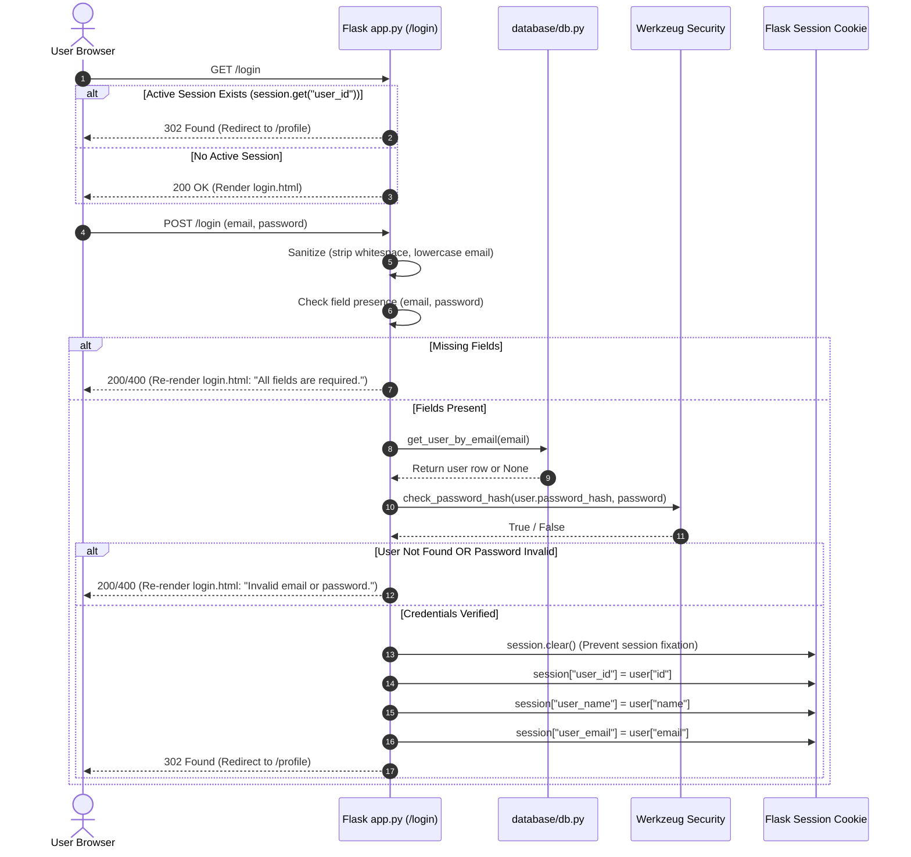
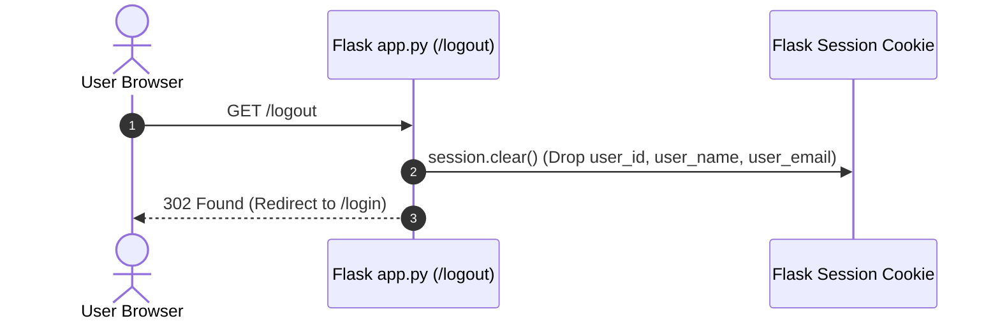

# Plan: 03 — User Login & Logout

> **Spec Document:** `specs/03-login-and-logout.md`  
> **Target Status:** Ready for Implementation  
> **Estimated Changes:** 3 files to modify (`expense-tracker/app.py`, `expense-tracker/templates/login.html`, `expense-tracker/templates/base.html`), 0 files to create, 0 new external dependencies.

---

## 1. Executive Summary

This plan provides a comprehensive technical blueprint for implementing **User Login & Session Authentication** and **Logout** within the Spendly application.

Building on the foundation established in Step 1 (Database) and Step 2 (Registration), this task transitions `/login` and `/logout` from static placeholders into a complete session-backed authentication subsystem. It ensures credentials are verified in constant-time against SQLite hashes using [`get_user_by_email()`](file:///c:/Users/Siddhant/Downloads/expense-tracker/expense-tracker/database/db.py#L120) from `database/db.py`, sets up signed cookie sessions via Flask's secret key, secures against account enumeration, prevents session fixation, and dynamically adapts global navigation in [`base.html`](file:///c:/Users/Siddhant/Downloads/expense-tracker/expense-tracker/templates/base.html).

---

## 2. Architecture & Design Specification

### 2.1 Authentication & Session Lifecycles

#### A. User Login Flow


#### B. User Logout Flow


---

### 2.2 Security Architecture

1. **Anti-Enumeration Error Consistency:**
   - Both non-existent email lookups and mismatched password hashes must return identical user-facing feedback:
     ```
     "Invalid email or password."
     ```
   - This eliminates account enumeration vectors where an attacker could deduce registered email addresses.

2. **Session Fixation Defense:**
   - Always call `session.clear()` immediately prior to writing authenticated user attributes into the session.

3. **Timing-Safe Password Evaluation:**
   - Verification must delegate entirely to `werkzeug.security.check_password_hash`, avoiding custom comparison operators vulnerable to timing side-channels.

4. **Cryptographic Signing Key (`app.secret_key`):**
   - Configured via environment variable with a resilient development fallback:
     ```python
     app.secret_key = os.environ.get("SECRET_KEY", "spendly-dev-secret-key-change-in-production")
     ```

5. **Data Layer Decoupling:**
   - In accordance with project policy (**"for database use only db.py"**), [`app.py`](file:///c:/Users/Siddhant/Downloads/expense-tracker/expense-tracker/app.py) must not import `sqlite3` or execute raw SQL. It interacts with the data layer solely through [`get_user_by_email()`](file:///c:/Users/Siddhant/Downloads/expense-tracker/expense-tracker/database/db.py#L120).

---

## 3. Step-by-Step Implementation Breakdown

### Step 1: Update Imports & Secret Key in `expense-tracker/app.py`
1. Add `os` and `session` to imports:
   ```python
   import os
   from flask import Flask, render_template, request, redirect, url_for, session
   from werkzeug.security import generate_password_hash, check_password_hash
   from database.db import init_db, seed_db, get_user_by_email, create_user
   ```
2. Configure `app.secret_key` right after `app = Flask(__name__)`:
   ```python
   app.secret_key = os.environ.get("SECRET_KEY", "spendly-dev-secret-key-change-in-production")
   ```

---

### Step 2: Implement `/login` Handler in `expense-tracker/app.py`
Replace the placeholder `login()` route with full `GET` and `POST` handling:

```python
@app.route("/login", methods=["GET", "POST"])
def login():
    # 1. Redirect if already authenticated
    if request.method == "GET" and session.get("user_id"):
        return redirect(url_for("profile"))

    if request.method == "POST":
        email = request.form.get("email", "").strip().lower()
        password = request.form.get("password", "")

        # 2. Validate field presence
        if not email or not password:
            return render_template(
                "login.html",
                error="All fields are required.",
                email=email
            )

        # 3. Retrieve user via db.py
        user = get_user_by_email(email)

        # 4. Verify user existence and password hash
        if not user or not check_password_hash(user["password_hash"], password):
            return render_template(
                "login.html",
                error="Invalid email or password.",
                email=email
            )

        # 5. Establish authenticated session
        session.clear()
        session["user_id"] = user["id"]
        session["user_name"] = user["name"]
        session["user_email"] = user["email"]

        # 6. Redirect to profile
        return redirect(url_for("profile"))

    return render_template("login.html")
```

---

### Step 3: Implement `/logout` Handler in `expense-tracker/app.py`
Replace the placeholder string return in `logout()` with clean session termination:

```python
@app.route("/logout")
def logout():
    session.clear()
    return redirect(url_for("login"))
```

---

### Step 4: Enhance `expense-tracker/templates/login.html`
Update the email input field to preserve user input on failed login attempts while keeping the password field empty:
```html
<input type="email" id="email" name="email"
       class="form-input" placeholder="Ujjwal@example.com"
       value="{{ email or '' }}"
       required autofocus>
```

---

### Step 5: Update Navigation in `expense-tracker/templates/base.html`
Wrap the navbar action links with Jinja conditional branching on `session.get('user_id')`:

```html
<div class="nav-links">
    
        <a href="{{ url_for('profile') }}">Profile</a>
        <a href="{{ url_for('logout') }}" class="nav-cta">Log out</a>
    
        <a href="{{ url_for('login') }}">Sign in</a>
        <a href="{{ url_for('register') }}" class="nav-cta">Get started</a>
    
</div>
```

---

## 4. Verification & Testing Matrix

| # | Test Scenario | Preconditions / Input | Execution Method | Expected Behavior |
| :---: | :--- | :--- | :--- | :--- |
| **1** | **GET `/login` (Anonymous)** | No active session | `client.get('/login')` | HTTP 200; renders `login.html` with empty form |
| **2** | **GET `/login` (Authenticated)** | `session['user_id'] = 1` | `client.get('/login')` | HTTP 302; redirects to `/profile` |
| **3** | **Missing Email** | `email=""`, `password="demo123"` | `client.post('/login', data=...)` | HTTP 200; renders error `"All fields are required."` |
| **4** | **Missing Password** | `email="demo@spendly.com"`, `password=""` | `client.post('/login', data=...)` | HTTP 200; renders error `"All fields are required."` |
| **5** | **Both Fields Missing** | `email=""`, `password=""` | `client.post('/login', data=...)` | HTTP 200; renders error `"All fields are required."` |
| **6** | **Non-Existent User** | `email="ghost@spendly.com"`, `password="pass12345"` | `client.post('/login', data=...)` | HTTP 200; renders `"Invalid email or password."`; session remains empty |
| **7** | **Wrong Password** | `email="demo@spendly.com"`, `password="wrongPass123"` | `client.post('/login', data=...)` | HTTP 200; renders `"Invalid email or password."`; session remains empty |
| **8** | **Valid Login (Seed User)** | `email="demo@spendly.com"`, `password="demo123"` | `client.post('/login', data=...)` | HTTP 302; redirects to `/profile`; `session['user_id'] == 1` |
| **9** | **Case-Insensitive Email** | `email="DEMO@SPENDLY.COM"`, `password="demo123"` | `client.post('/login', data=...)` | HTTP 302; authenticates successfully against normalized email |
| **10** | **Whitespace Trimming** | `email="  demo@spendly.com  "`, `password="demo123"` | `client.post('/login', data=...)` | HTTP 302; authenticates successfully |
| **11** | **GET `/logout`** | Active session (`user_id = 1`) | `client.get('/logout')` | HTTP 302; redirects to `/login`; `session` is completely emptied |
| **12** | **Navbar State (Logged In)** | `session['user_id'] = 1` | Inspect rendered HTML | Displays links for "Profile" and "Log out"; hides "Sign in" and "Get started" |
| **13** | **Navbar State (Logged Out)**| No session | Inspect rendered HTML | Displays links for "Sign in" and "Get started"; hides "Profile" and "Log out" |

---

## 5. Potential Risks & Failure Modes with Mitigations

1. **Unset Secret Key Runtime Error:**
   - *Risk:* Calling `session[...]` without `app.secret_key` raises a `RuntimeError: The session is unavailable because no secret key was set.`
   - *Mitigation:* Explicitly assign `app.secret_key = os.environ.get("SECRET_KEY", "spendly-dev-secret-key-change-in-production")` during application initialization.

2. **Session Hijacking / Fixation:**
   - *Risk:* An attacker pre-seeds a session cookie and tricks a user into logging in under that session ID.
   - *Mitigation:* Invoke `session.clear()` immediately before assigning user details upon successful authentication.

3. **Account Enumeration Discrepancies:**
   - *Risk:* Differentiating errors between "User not found" and "Incorrect password" permits attackers to scrape valid email lists.
   - *Mitigation:* Consistently return `"Invalid email or password."` for both scenarios.

4. **Database Decoupling Violations:**
   - *Risk:* Implementing raw queries in `app.py` compromises architecture and makes connection management error-prone.
   - *Mitigation:* Ensure `app.py` calls `get_user_by_email` from `database/db.py` exclusively.
