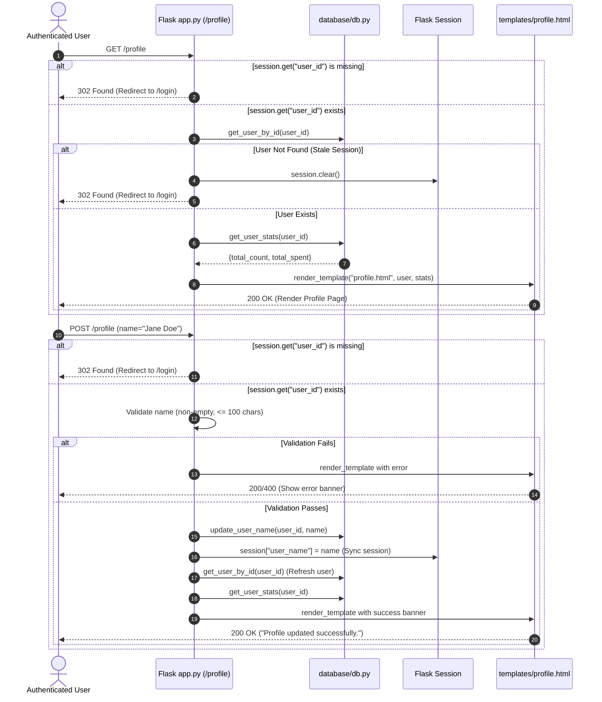

# Plan: 04 — User Profile Page Design & Management

> **Spec Document:** `specs/04-profile-page-design.md`  
> **Target Status:** Ready for Implementation  
> **Estimated Changes:** 3 files to modify (`expense-tracker/database/db.py`, `expense-tracker/app.py`, `expense-tracker/static/css/style.css`), 1 file to create (`expense-tracker/templates/profile.html`), 0 new external dependencies.

---

## 1. Executive Summary

This plan provides a step-by-step engineering roadmap for implementing the **User Profile Page Design & Account Management** feature in the Spendly personal finance application.

Following the design specification in [`04-profile-page-design.md`](file:///c:/Users/Siddhant/Downloads/expense-tracker/.anitigravity/specs/04-profile-page-design.md), this task transitions the `/profile` endpoint from a placeholder string into a rich, responsive account hub. It ensures complete access control (authenticated-only with automatic login redirects), fetches user activity statistics (total logged transactions and total spend), provides an interactive form to update display names with instant session synchronization, preserves email immutability, and implements Spendly's signature warm editorial aesthetic (DM Serif Display typography, paper surfaces, and forest green accents).

---

## 2. Architecture & Design Specification

### 2.1 Request & Data Lifecycle



---

### 2.2 Data Layer Architecture (`database/db.py`)

In strict accordance with the project rule (**"for database use only db.py"**):
- **No raw SQL in `app.py`.**
- Two new data helper functions are added to [`database/db.py`](file:///c:/Users/Siddhant/Downloads/expense-tracker/expense-tracker/database/db.py):
  1. `update_user_name(user_id, name)`: Parameterized update query (`UPDATE users SET name = ? WHERE id = ?`).
  2. `get_user_stats(user_id)`: Parameterized aggregation query on `expenses` table (`COUNT(*)` and `COALESCE(SUM(amount), 0.0)`).
- Both functions use `try...finally: conn.close()` to guarantee connection cleanup.

---

### 2.3 UI & Visual Component Architecture

The visual layout adheres strictly to Spendly's design tokens:
- **Canvas:** `--paper` (`#f7f6f3`)
- **Card Surface:** `--paper-card` (`#ffffff`) with 1px solid `--border` (`#e4e1da`) and `--radius-md` (`12px`)
- **Avatar Badge:** 72px circular badge with `--accent` background (#1a472a) and capitalized initial letter in `'DM Serif Display'`
- **Metrics Grid:** Responsive 3-card grid (Transaction count, Lifetime spend in ₹, and Account Tier)
- **Settings Form:** Clean input controls with editable name and locked read-only email

---

## 3. Step-by-Step Implementation Breakdown

### Step 1: Implement Database Helpers in `expense-tracker/database/db.py`

Add `update_user_name` and `get_user_stats` to the `# User operations` section in [`database/db.py`](file:///c:/Users/Siddhant/Downloads/expense-tracker/expense-tracker/database/db.py):

```python
def update_user_name(user_id, name):
    """Update a user's display name. Returns True on success, False otherwise."""
    conn = get_db()
    cursor = conn.cursor()
    try:
        cursor.execute(
            "UPDATE users SET name = ? WHERE id = ?;",
            (name.strip(), user_id)
        )
        conn.commit()
        return cursor.rowcount > 0
    finally:
        conn.close()


def get_user_stats(user_id):
    """Calculate summary stats for a user's expenses.
    Returns a dict with: total_count, total_spent.
    """
    conn = get_db()
    cursor = conn.cursor()
    try:
        row = cursor.execute("""
            SELECT 
                COUNT(*) as total_count,
                COALESCE(SUM(amount), 0.0) as total_spent
            FROM expenses
            WHERE user_id = ?;
        """, (user_id,)).fetchone()

        return {
            "total_count": int(row["total_count"]) if row else 0,
            "total_spent": float(row["total_spent"]) if row else 0.0
        }
    finally:
        conn.close()
```

---

### Step 2: Implement `/profile` Route in `expense-tracker/app.py`

1. Update imports from `database.db`:
   ```python
   from database.db import (
       init_db, seed_db, get_user_by_email, create_user,
       get_user_by_id, update_user_name, get_user_stats
   )
   ```
2. Replace the placeholder `@app.route("/profile")` with full `GET` and `POST` logic:
   ```python
   @app.route("/profile", methods=["GET", "POST"])
   def profile():
       user_id = session.get("user_id")
       if not user_id:
           return redirect(url_for("login"))

       user = get_user_by_id(user_id)
       if not user:
           session.clear()
           return redirect(url_for("login"))

       stats = get_user_stats(user_id)
       error = None
       success = None

       if request.method == "POST":
           name = request.form.get("name", "").strip()
           if not name:
               error = "Name cannot be empty."
           elif len(name) > 100:
               error = "Name must not exceed 100 characters."
           else:
               update_user_name(user_id, name)
               session["user_name"] = name
               user = get_user_by_id(user_id)  # Refresh updated user record
               success = "Profile updated successfully."

       return render_template(
           "profile.html",
           user=user,
           stats=stats,
           error=error,
           success=success
       )
   ```

---

### Step 3: Create Template `expense-tracker/templates/profile.html`

Create the Jinja2 template extending `base.html`:
- Set page title: `Profile — Spendly`
- Profile Header Card:
  - Avatar badge showing `{{ user.name[0].upper() }}`
  - User name, email, member since date (`{{ user.created_at[:10] }}` or formatted)
  - Account status pill badge (`Active · Free Plan`)
- Metrics Grid:
  - Card 1: `{{ stats.total_count }}` total transactions logged
  - Card 2: `₹{{ "%.2f"|format(stats.total_spent) }}` lifetime spending
  - Card 3: Free Tier status indicator
- Personal Information Form:
  - Error and success alert blocks
  - Editable `name` field (`value="{{ user.name }}"`)
  - Read-only `email` field (`value="{{ user.email }}"`, `readonly`, `class="form-input form-input-readonly"`)
  - Submit button (`Save Changes`)
- Actions Footer:
  - Link to return to home/dashboard (`← Back to Home`)
  - Link to sign out (`Sign out`)

---

### Step 4: Add CSS Styles in `expense-tracker/static/css/style.css`

Add profile-specific styling under a dedicated comment section `/* Profile Page */`:
- `.profile-section`: Vertical padding `3rem 1.5rem`.
- `.profile-container`: Max-width `780px`, centered.
- `.profile-header-card`: Flex layout aligning avatar and details.
- `.profile-avatar`: 72px circular avatar with `--accent` background and `'DM Serif Display'` typography.
- `.profile-stats-grid`: 3-column CSS Grid (`grid-template-columns: repeat(3, 1fr); gap: 1rem;`) collapsing to 1 column on mobile (`@media (max-width: 640px)`).
- `.profile-stat-card`: Surface card with subtle border and typography tokens.
- `.form-input-readonly`: Readonly input style with `--paper-warm` background and muted text.
- `.alert-success`: Green success notification banner using `--accent-light` and `--accent`.

---

## 4. Verification & Testing Matrix

| # | Test Scenario | Preconditions / Input | Execution Method | Expected Behavior |
| :---: | :--- | :--- | :--- | :--- |
| **1** | **Unauthenticated GET** | No session | `client.get('/profile')` | HTTP 302; redirects to `/login` |
| **2** | **Unauthenticated POST** | No session | `client.post('/profile', data=...)` | HTTP 302; redirects to `/login` |
| **3** | **Stale Session GET** | `session['user_id'] = 9999` (non-existent) | `client.get('/profile')` | HTTP 302; clears session; redirects to `/login` |
| **4** | **Authenticated GET (Demo User)** | `session['user_id'] = 1` | `client.get('/profile')` | HTTP 200; renders `profile.html` with Demo User, demo@spendly.com, and avatar 'D' |
| **5** | **Expense Stats Accuracy** | Seed expenses present for user 1 | `client.get('/profile')` | Stats reflect 8 transactions and ₹6,170.00 spent |
| **6** | **Valid Name Update** | `name="Jane Doe"` | `client.post('/profile', data=...)` | HTTP 200; shows `"Profile updated successfully."`; DB and `session['user_name']` updated to `"Jane Doe"` |
| **7** | **Empty Name Validation** | `name=""` or `name="   "` | `client.post('/profile', data=...)` | HTTP 200; shows `"Name cannot be empty."`; DB name remains unchanged |
| **8** | **Name Length Validation** | `name="A" * 101` | `client.post('/profile', data=...)` | HTTP 200; shows `"Name must not exceed 100 characters."`; DB name remains unchanged |
| **9** | **Read-Only Email** | Inspect rendered HTML | Query email input | Input contains `readonly` attribute; email is not updated |
| **10** | **Mobile Responsiveness** | Viewport width 375px | CSS inspection | Stat cards stack into a single column without horizontal scroll |

---

## 5. Potential Risks & Failure Modes with Mitigations

1. **Stale Session State:**
   - *Risk:* A user account was deleted or database re-seeded, but a client still holds a valid session cookie for an old ID. Calling `user["name"]` would raise `TypeError: 'NoneType' object is not subscriptable`.
   - *Mitigation:* Explicitly check `if not user:` after `get_user_by_id(user_id)`. If `None`, clear session and redirect to `/login`.

2. **Session / DB Desynchronization:**
   - *Risk:* Updating the name in the database without updating Flask's session means the top navbar continues showing the old name until the user logs out and back in.
   - *Mitigation:* Update `session["user_name"] = name` immediately following successful database execution.

3. **Database Layer Boundary Leak:**
   - *Risk:* Writing inline SQL in `app.py` compromises the architectural separation established in Step 2 and Step 3.
   - *Mitigation:* Encapsulate all queries in `database/db.py` (`update_user_name`, `get_user_stats`).

4. **Empty Database Stats Handling:**
   - *Risk:* A newly registered user has zero expenses; `SUM(amount)` in SQLite returns `NULL`.
   - *Mitigation:* Use `COALESCE(SUM(amount), 0.0)` in the SQL query and guard with `.get("total_spent", 0.0)` to ensure numbers format cleanly.
