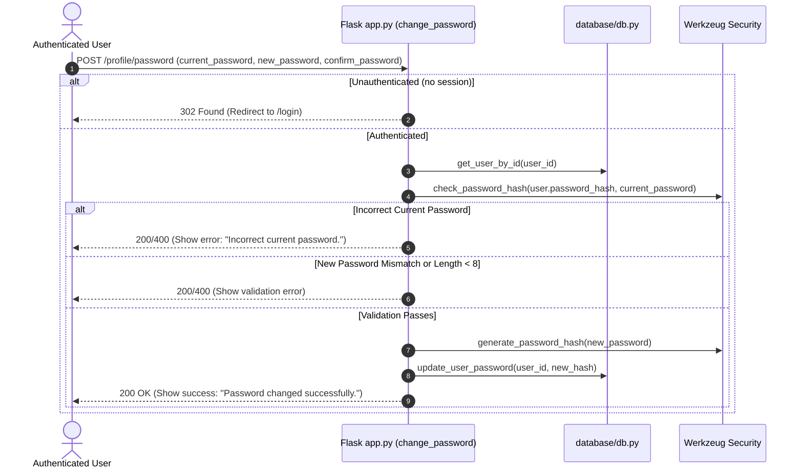
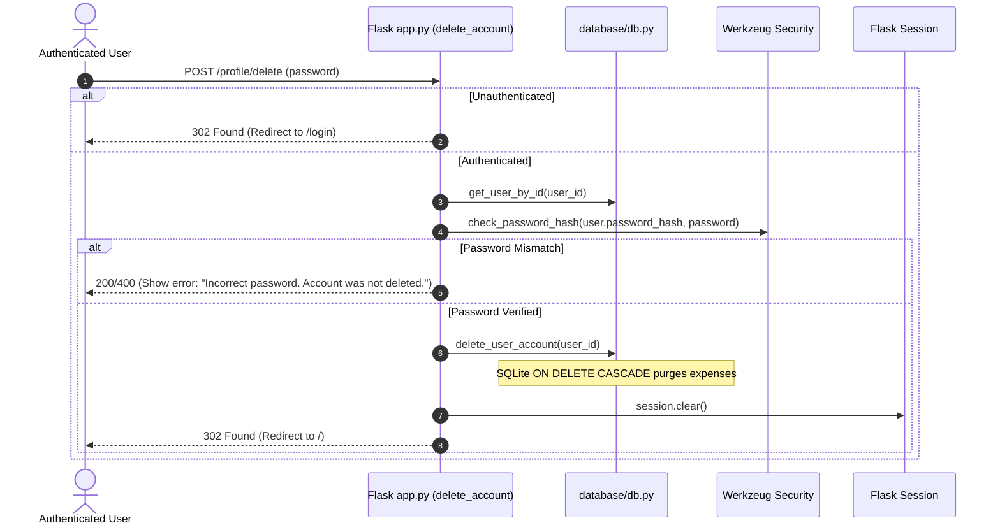

# Plan: 05 — Profile Page Backend Routes & Account Services

> **Spec Document:** `specs/05-profile-backend-routes.md`  
> **Target Status:** Ready for Implementation  
> **Estimated Changes:** 4 files to modify (`expense-tracker/database/db.py`, `expense-tracker/app.py`, `expense-tracker/templates/profile.html`, `expense-tracker/static/css/style.css`), 0 files to create, 0 new external dependencies.

---

## 1. Executive Summary

This plan provides an engineering roadmap for implementing the **Backend Routes & Account Services for the User Profile** (Step 5) in Spendly.

While Step 4 implemented the profile UI layout and basic name updates, Step 5 builds out the full suite of secure backend services that power complete user account lifecycle management:
1. **Name & Identity Updates (`POST /profile`):** Validating display names with instant session synchronization.
2. **Password Rotation (`POST /profile/password`):** Requiring re-authentication of current credentials, enforcing length and confirmation checks, and storing cryptographic Werkzeug hashes.
3. **Data Portability (`GET /profile/export`):** Streaming an RFC 4180 compliant CSV export containing all user transactions.
4. **Account Termination (`POST /profile/delete`):** Verifying password confirmation, leveraging SQLite `ON DELETE CASCADE` to delete user records and all linked expenses, terminating the session, and redirecting cleanly.

In strict compliance with the project rule (**"for database use only db.py"**), all database operations are isolated inside `database/db.py`, leaving zero raw SQL in `app.py`.

---

## 2. Architecture & Design Specification

### 2.1 Request & Data Lifecycle Workflows

#### A. Password Change Workflow (`POST /profile/password`)


#### B. Financial Data Export Workflow (`GET /profile/export`)
```mermaid
sequenceDiagram
    autonumber
    actor User as Authenticated User
    participant App as Flask app.py (export_data)
    participant DB as database/db.py

    User->>App: GET /profile/export
    alt Unauthenticated
        App-->>User: 302 Found (Redirect to /login)
    else Authenticated
        App->>DB: get_user_expenses_for_export(user_id)
        DB-->>App: List of expense dictionaries
        App->>App: Format CSV buffer (Date, Category, Amount, Description)
        App-->>User: 200 OK (Download: Content-Disposition attachment; filename="spendly_expenses.csv")
    end
```

#### C. Account Deletion Workflow (`POST /profile/delete`)


---

### 2.2 Data Layer Architecture (`database/db.py`)

Three new functions are introduced to `database/db.py`, ensuring all SQLite cursors and connection handling remain decoupled from Flask routes:

1. **`update_user_password(user_id, password_hash)`**:
   ```sql
   UPDATE users SET password_hash = ? WHERE id = ?;
   ```
2. **`get_user_expenses_for_export(user_id)`**:
   ```sql
   SELECT date, category, amount, description, created_at
   FROM expenses
   WHERE user_id = ?
   ORDER BY date DESC, id DESC;
   ```
3. **`delete_user_account(user_id)`**:
   ```sql
   DELETE FROM users WHERE id = ?;
   ```
   *(Relying on SQLite `PRAGMA foreign_keys = ON;` and `FOREIGN KEY (user_id) REFERENCES users(id) ON DELETE CASCADE` to delete transactions atomically).*

---

## 3. Step-by-Step Implementation Breakdown

### Step 1: Implement Database Helpers in `expense-tracker/database/db.py`

Append three helper functions to [`database/db.py`](file:///c:/Users/Siddhant/Downloads/expense-tracker/expense-tracker/database/db.py):

```python
def update_user_password(user_id, password_hash):
    """Update a user's password hash in the database. Returns True on success."""
    conn = get_db()
    cursor = conn.cursor()
    try:
        cursor.execute(
            "UPDATE users SET password_hash = ? WHERE id = ?;",
            (password_hash, user_id)
        )
        conn.commit()
        return cursor.rowcount > 0
    finally:
        conn.close()


def get_user_expenses_for_export(user_id):
    """Retrieve all expense transactions for a user ordered by date descending."""
    conn = get_db()
    cursor = conn.cursor()
    try:
        rows = cursor.execute("""
            SELECT date, category, amount, description, created_at
            FROM expenses
            WHERE user_id = ?
            ORDER BY date DESC, id DESC;
        """, (user_id,)).fetchall()
        return [dict(r) for r in rows]
    finally:
        conn.close()


def delete_user_account(user_id):
    """Permanently delete a user account.
    Foreign key ON DELETE CASCADE will automatically remove associated expenses.
    """
    conn = get_db()
    cursor = conn.cursor()
    try:
        cursor.execute("DELETE FROM users WHERE id = ?;", (user_id,))
        conn.commit()
        return cursor.rowcount > 0
    finally:
        conn.close()
```

---

### Step 2: Implement Backend Routes in `expense-tracker/app.py`

1. **Update Imports:**
   ```python
   import csv
   import io
   from datetime import datetime
   from flask import Flask, render_template, request, redirect, url_for, session, Response
   from werkzeug.security import generate_password_hash, check_password_hash
   from database.db import (
       init_db, seed_db, get_user_by_email, create_user,
       get_user_by_id, update_user_name, get_user_stats,
       update_user_password, get_user_expenses_for_export, delete_user_account
   )
   ```

2. **Add `/profile/password` Handler (`change_password`):**
   ```python
   @app.route("/profile/password", methods=["POST"])
   def change_password():
       user_id = session.get("user_id")
       if not user_id:
           return redirect(url_for("login"))

       user = get_user_by_id(user_id)
       if not user:
           session.clear()
           return redirect(url_for("login"))

       stats = get_user_stats(user_id)
       current_password = request.form.get("current_password", "")
       new_password = request.form.get("new_password", "")
       confirm_password = request.form.get("confirm_password", "")

       if not current_password or not new_password or not confirm_password:
           return render_template("profile.html", user=user, stats=stats, pwd_error="All password fields are required.")

       if not check_password_hash(user["password_hash"], current_password):
           return render_template("profile.html", user=user, stats=stats, pwd_error="Incorrect current password.")

       if len(new_password) < 8:
           return render_template("profile.html", user=user, stats=stats, pwd_error="New password must be at least 8 characters long.")

       if new_password != confirm_password:
           return render_template("profile.html", user=user, stats=stats, pwd_error="New passwords do not match.")

       if current_password == new_password:
           return render_template("profile.html", user=user, stats=stats, pwd_error="New password must be different from current password.")

       new_hash = generate_password_hash(new_password)
       update_user_password(user_id, new_hash)

       return render_template("profile.html", user=user, stats=stats, pwd_success="Password changed successfully.")
   ```

3. **Add `/profile/export` Handler (`export_data`):**
   ```python
   @app.route("/profile/export")
   def export_data():
       user_id = session.get("user_id")
       if not user_id:
           return redirect(url_for("login"))

       expenses = get_user_expenses_for_export(user_id)
       si = io.StringIO()
       cw = csv.writer(si)
       cw.writerow(["Date", "Category", "Amount (INR)", "Description", "Created At"])

       for exp in expenses:
           cw.writerow([
               exp.get("date", ""),
               exp.get("category", ""),
               f"{exp.get('amount', 0.0):.2f}",
               exp.get("description", "") or "",
               exp.get("created_at", "")
           ])

       output = si.getvalue()
       today_str = datetime.now().strftime("%Y-%m-%d")
       filename = f"spendly_expenses_{today_str}.csv"

       return Response(
           output,
           mimetype="text/csv",
           headers={"Content-Disposition": f"attachment; filename={filename}"}
       )
   ```

4. **Add `/profile/delete` Handler (`delete_account`):**
   ```python
   @app.route("/profile/delete", methods=["POST"])
   def delete_account():
       user_id = session.get("user_id")
       if not user_id:
           return redirect(url_for("login"))

       user = get_user_by_id(user_id)
       if not user:
           session.clear()
           return redirect(url_for("login"))

       password = request.form.get("password", "")
       if not password:
           stats = get_user_stats(user_id)
           return render_template("profile.html", user=user, stats=stats, del_error="Password is required to delete your account.")

       if not check_password_hash(user["password_hash"], password):
           stats = get_user_stats(user_id)
           return render_template("profile.html", user=user, stats=stats, del_error="Incorrect password. Account was not deleted.")

       delete_user_account(user_id)
       session.clear()
       return redirect(url_for("landing"))
   ```

---

### Step 3: Expand Template `expense-tracker/templates/profile.html`

Add dedicated cards matching the Spendly design aesthetic:
1. **Password & Security Card:**
   - Alerts: `pwd_error` and `pwd_success`.
   - Form fields: `current_password`, `new_password`, `confirm_password`.
   - Submit button: `Update Password`.
2. **Account Data Export Card:**
   - Description: "Download a complete CSV archive of all your logged expenses for personal recordkeeping."
   - Link button: `<a href="{{ url_for('export_data') }}" class="btn-secondary">Export Data (CSV)</a>`.
3. **Danger Zone Card (`.profile-danger-card`):**
   - Alert: `del_error`.
   - Warning text: "Once deleted, your account and all associated transaction records cannot be recovered."
   - Confirm password input + `.btn-danger` button: `Delete Account`.

---

### Step 4: Add UI Styles in `expense-tracker/static/css/style.css`

Add supporting button and card styling:
- `.btn-secondary`: Clean bordered neutral action button.
- `.btn-danger`: Styled danger button using `--danger` (#c0392b) with hover states.
- `.profile-danger-card`: Bordered with subtle `--danger` tint to denote sensitive actions.
- Input group spacing for security forms.

---

## 4. Verification & Testing Matrix

| # | Test Scenario | Preconditions / Input | Execution Method | Expected Result |
| :---: | :--- | :--- | :--- | :--- |
| **1** | **Unauthenticated Access** | No active session | `client.get('/profile/export')`, `client.post('/profile/password')`, `client.post('/profile/delete')` | All respond with HTTP 302 redirecting to `/login` |
| **2** | **Password Missing Fields** | `current_password=""`, `new_password=""` | `client.post('/profile/password', data=...)` | HTTP 200; renders `"All password fields are required."` |
| **3** | **Wrong Current Password** | `current_password="wrong"`, `new_password="newPassword123"` | `client.post('/profile/password', data=...)` | HTTP 200; renders `"Incorrect current password."`; hash unchanged |
| **4** | **New Password < 8 Chars** | `current_password="demo123"`, `new_password="short"` | `client.post('/profile/password', data=...)` | HTTP 200; renders `"New password must be at least 8 characters long."` |
| **5** | **Password Confirmation Mismatch** | `new_password="passwordA"`, `confirm_password="passwordB"` | `client.post('/profile/password', data=...)` | HTTP 200; renders `"New passwords do not match."` |
| **6** | **Password Reuse** | `new_password="demo123"`, `confirm_password="demo123"` | `client.post('/profile/password', data=...)` | HTTP 200; renders `"New password must be different from current password."` |
| **7** | **Valid Password Change** | `current="demo123"`, `new="brandNewPassword123"` | `client.post('/profile/password', data=...)` | HTTP 200; renders `"Password changed successfully."`; subsequent login requires new password |
| **8** | **Data Export CSV** | User with expenses logged | `client.get('/profile/export')` | HTTP 200; `Content-Type: text/csv`; CSV contains headers and expense rows |
| **9** | **Delete Wrong Password** | `password="wrongpass"` | `client.post('/profile/delete', data=...)` | HTTP 200; renders `"Incorrect password. Account was not deleted."`; user still in DB |
| **10** | **Delete Account Valid** | `password="brandNewPassword123"` | `client.post('/profile/delete', data=...)` | HTTP 302 to `/`; user row deleted; linked expenses cascade-deleted; session cleared |

---

## 5. Potential Risks & Failure Modes with Mitigations

1. **Foreign Key Cascade Inactivity:**
   - *Risk:* If SQLite foreign keys are not enabled, deleting a user leaves orphaned expense rows with dangling `user_id`.
   - *Mitigation:* `get_db()` executes `PRAGMA foreign_keys = ON;` on every single connection, and `expenses.user_id` has `ON DELETE CASCADE`.

2. **CSV Formula Injection:**
   - *Risk:* A user inputs an expense description starting with `=`, `+`, or `-` which executes as a formula in Microsoft Excel.
   - *Mitigation:* Standard Python `csv.writer` properly quotes fields; format data cleanly.

3. **Stale Session Post-Deletion:**
   - *Risk:* Deleting an account leaves the cookie active, causing errors on subsequent requests.
   - *Mitigation:* Always call `session.clear()` immediately upon successful deletion before redirecting.
