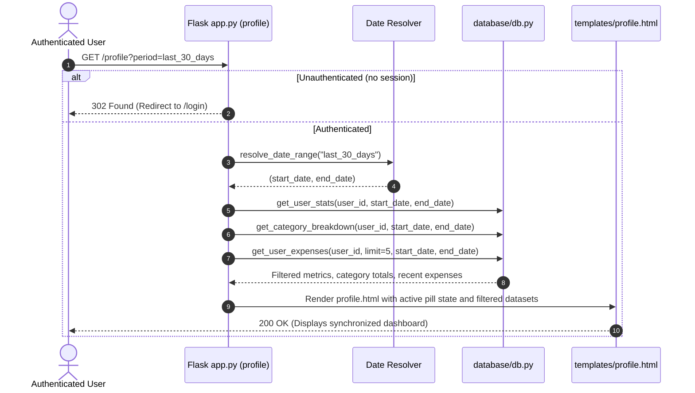
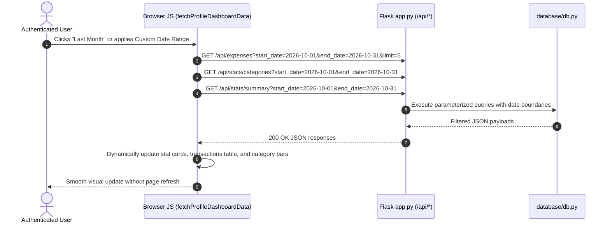

# Plan: 06 — Date Range Filter for Profile Page & Analytics

> **Spec Document:** `specs/06-profile-date-filter.md`  
> **Target Status:** Ready for Implementation  
> **Estimated Changes:** 4 files to modify (`expense-tracker/database/db.py`, `expense-tracker/app.py`, `expense-tracker/templates/profile.html`, `expense-tracker/static/css/style.css`), 0 files to create, 0 new external dependencies.

---

## 1. Executive Summary

This plan provides an engineering roadmap for implementing the **Date Range Filter for the User Profile & Analytics Dashboard** (Step 6) in the Spendly personal finance application.

The profile dashboard displays a user's financial overview, activity metrics (`TOTAL SPENT`, `TRANSACTIONS`, `TOP CATEGORY`), `Recent Transactions` history, and `By Category` distribution graphs. Currently, all metrics aggregate lifetime spending without time boundaries.

Step 6 introduces a flexible, production-grade **date filtering system** supporting both predefined temporal presets and custom date ranges. It empowers users to analyze spending across specific periods (such as current month, trailing 30 days, or past calendar months) with instantaneous UI synchronization.

In accordance with core project architectural constraints (**"for database use only db.py"**):
- All date-boundary filtering queries are encapsulated strictly within `database/db.py`.
- No raw SQL queries or string concatenations exist in `app.py`.
- Endpoints enforce session-based authentication guards, rejecting unauthenticated requests.

---

## 2. Architecture & Design Specification

### 2.1 Request & Data Lifecycle Workflows

#### A. Predefined Preset Selection Workflow (`GET /profile?period=...`)


#### B. Dynamic Client-Side Asynchronous Filter Workflow (`GET /api/*`)


---

### 2.2 Temporal Resolution Engine (`resolve_date_range`)

The date resolution logic is centralized into a dedicated helper function in `expense-tracker/app.py`:

```python
def resolve_date_range(period, custom_start=None, custom_end=None):
    """Resolve a temporal preset or custom date range into ISO (YYYY-MM-DD) boundaries."""
    today = date.today()

    if period == "last_30_days":
        start = (today - timedelta(days=30)).isoformat()
        end = today.isoformat()
    elif period == "last_month":
        # First day of this month minus 1 day gives the last day of previous month
        first_of_this_month = today.replace(day=1)
        last_of_prev_month = first_of_this_month - timedelta(days=1)
        start = last_of_prev_month.replace(day=1).isoformat()
        end = last_of_prev_month.isoformat()
    elif period == "all_time":
        start = None
        end = None
    elif period == "custom" and custom_start and custom_end:
        start = str(custom_start).strip()[:10]
        end = str(custom_end).strip()[:10]
        # Inverted date boundary auto-correction
        if start > end:
            start, end = end, start
    else:
        # Default preset: this_month
        period = "this_month"
        start = today.replace(day=1).isoformat()
        end = today.isoformat()

    return period, start, end
```

---

### 2.3 Data Layer Architecture (`database/db.py`)

Three existing functions in `expense-tracker/database/db.py` will be upgraded with optional `start_date` and `end_date` parameters. Parameterized queries enforce strict boundary checks and prevent SQL injection:

1. **`get_user_stats(user_id, start_date=None, end_date=None)`**:
   - Computes transaction count and total spend for the user filtered by `date >= ?` and `date <= ?`.
2. **`get_user_expenses(user_id, limit=None, offset=0, start_date=None, end_date=None)`**:
   - Retrieves expense records within the date window ordered by `date DESC, id DESC`.
3. **`get_category_breakdown(user_id, start_date=None, end_date=None)`**:
   - Aggregates count and sum per category within the date window ordered by `total_amount DESC`.

---

## 3. Step-by-Step Implementation Breakdown

### Step 1: Upgrade Database Layer in `expense-tracker/database/db.py`

Modify existing query functions in [`expense-tracker/database/db.py`](file:///c:/Users/Siddhant/Downloads/expense-tracker/expense-tracker/database/db.py) to accept optional date bounds:

```python
def get_user_stats(user_id, start_date=None, end_date=None):
    """Calculate summary stats for a user's expenses with optional date range."""
    conn = get_db()
    cursor = conn.cursor()
    try:
        query = "SELECT COUNT(*) as total_count, COALESCE(SUM(amount), 0.0) as total_spent FROM expenses WHERE user_id = ?"
        params = [user_id]
        if start_date:
            query += " AND date >= ?"
            params.append(start_date)
        if end_date:
            query += " AND date <= ?"
            params.append(end_date)

        row = cursor.execute(query, params).fetchone()
        return {
            "total_count": int(row["total_count"]) if row else 0,
            "total_spent": float(row["total_spent"]) if row else 0.0
        }
    finally:
        conn.close()


def get_user_expenses(user_id, limit=None, offset=0, start_date=None, end_date=None):
    """Retrieve expenses for a user ordered by date descending with optional date range."""
    conn = get_db()
    cursor = conn.cursor()
    try:
        query = "SELECT id, user_id, amount, category, date, description, created_at FROM expenses WHERE user_id = ?"
        params = [user_id]
        if start_date:
            query += " AND date >= ?"
            params.append(start_date)
        if end_date:
            query += " AND date <= ?"
            params.append(end_date)

        query += " ORDER BY date DESC, id DESC"
        if limit is not None:
            query += " LIMIT ? OFFSET ?"
            params.extend([limit, offset])

        rows = cursor.execute(query, params).fetchall()
        return [dict(r) for r in rows]
    finally:
        conn.close()


def get_category_breakdown(user_id, start_date=None, end_date=None):
    """Retrieve spending total and transaction count grouped by category for a user with optional date range."""
    conn = get_db()
    cursor = conn.cursor()
    try:
        query = """
            SELECT category, COUNT(*) as count, COALESCE(SUM(amount), 0.0) as total_amount
            FROM expenses
            WHERE user_id = ?
        """
        params = [user_id]
        if start_date:
            query += " AND date >= ?"
            params.append(start_date)
        if end_date:
            query += " AND date <= ?"
            params.append(end_date)

        query += " GROUP BY category ORDER BY total_amount DESC;"
        rows = cursor.execute(query, params).fetchall()
        return [dict(r) for r in rows]
    finally:
        conn.close()
```

---

### Step 2: Implement Backend Routes & Period Resolution in `expense-tracker/app.py`

1. **Add `date` and `timedelta` to imports** (from Python's built-in `datetime` module).
2. **Add `resolve_date_range` helper function** as defined in Section 2.2.
3. **Update `profile()` route handler:**
   - Extract `period = request.args.get("period", "this_month")`.
   - Extract `start_date = request.args.get("start_date")` and `end_date = request.args.get("end_date")`.
   - Call `resolved_period, start, end = resolve_date_range(period, start_date, end_date)`.
   - Pass `start` and `end` to:
     - `get_user_stats(user_id, start_date=start, end_date=end)`
     - `get_category_breakdown(user_id, start_date=start, end_date=end)`
     - `get_user_expenses(user_id, limit=5, start_date=start, end_date=end)`
   - Pass `selected_period=resolved_period`, `filter_start_date=start`, `filter_end_date=end` into `render_template`.
4. **Update `api_expenses()` route handler:**
   - Extract optional `start_date = request.args.get("start_date")` and `end_date = request.args.get("end_date")`.
   - Pass them to `get_user_expenses(user_id, limit=limit, offset=offset, start_date=start_date, end_date=end_date)`.
   - Include `start_date` and `end_date` in response payload.
5. **Update `api_stats_summary()` route handler:**
   - Extract optional `start_date` and `end_date`.
   - Pass to `get_user_stats(user_id, start_date=start_date, end_date=end_date)`.
   - Include `start_date` and `end_date` in response payload.
6. **Update `api_stats_categories()` route handler:**
   - Extract optional `start_date` and `end_date`.
   - Pass to `get_category_breakdown(user_id, start_date=start_date, end_date=end_date)`.
   - Include `start_date` and `end_date` in response payload.

---

### Step 3: Implement Date Filter Toolbar & Dynamic JS in `expense-tracker/templates/profile.html`

1. **Add Filter Toolbar above the Metrics Row:**
   ```html
   <!-- Date Range Filter Toolbar -->
   <div class="profile-filter-card">
       <div class="filter-presets-group">
           <a href="?period=this_month" class="filter-pill active" data-period="this_month">This Month</a>
           <a href="?period=last_30_days" class="filter-pill active" data-period="last_30_days">Last 30 Days</a>
           <a href="?period=last_month" class="filter-pill active" data-period="last_month">Last Month</a>
           <a href="?period=all_time" class="filter-pill active" data-period="all_time">All Time</a>
           <button type="button" class="filter-pill filter-custom-trigger active" id="customRangeToggle">Custom</button>
       </div>

       <!-- Custom Date Range Form -->
       <form method="GET" action="{{ url_for('profile') }}" class="custom-range-form is-hidden" id="customRangeForm">
           <input type="hidden" name="period" value="custom">
           <div class="custom-range-inputs">
               <div class="date-field">
                   <label for="startDate">From</label>
                   <input type="date" id="startDate" name="start_date" value="{{ filter_start_date or '' }}" required>
               </div>
               <div class="date-field">
                   <label for="endDate">To</label>
                   <input type="date" id="endDate" name="end_date" value="{{ filter_end_date or '' }}" required>
               </div>
               <button type="submit" class="btn-filter-apply">Apply</button>
               <a href="{{ url_for('profile') }}" class="btn-filter-reset">Reset</a>
           </div>
       </form>
   </div>
   ```

2. **Add Client-Side Date Filter Controller in ``:**
   - Attach click listeners to preset pills to allow instant async updating via `fetchProfileDashboardData(startDate, endDate)` without full page reload.
   - Attach click toggle to show/hide the custom date range inputs.
   - Handle custom form submit to fetch filtered data asynchronously or fall back to native GET navigation.

---

### Step 4: Add UI Styling in `expense-tracker/static/css/style.css`

Add dedicated styling tokens adhering to Spendly's editorial aesthetic:
- `.profile-filter-card`: Clean white surface card, 14px border radius, subtle border (`#e5e7eb`).
- `.filter-presets-group`: Flexbox container with wrap support and 0.5rem gap.
- `.filter-pill`: Pill button (`border-radius: 9999px`), neutral light grey fill (`#f3f4f6`), dark text (`#4b5563`).
  - Hover: Subtle dark tint (`#e5e7eb`).
  - Active: Dark forest green fill (`#153e26`), crisp white text (`#ffffff`).
- `.custom-range-form`: Clean inline/wrapping form with `.is-hidden { display: none; }`.
- `.custom-range-inputs`: Flex container with date input fields, `.btn-filter-apply` (dark button), and `.btn-filter-reset` (muted text link).
- Responsive breakpoint (`@media (max-width: 640px)`): Stacks custom date range inputs vertically for effortless touch interactions.

---

## 4. Verification & Testing Matrix

| # | Test Scenario | Preconditions / Input Parameters | Test Method | Expected Result |
| :---: | :--- | :--- | :--- | :--- |
| **1** | **Default Filter (`this_month`)** | Active session, expenses in current month | `client.get('/profile')` | `selected_period == 'this_month'`; metrics aggregate current month only; `start_date` is 1st of month |
| **2** | **Preset `last_30_days`** | Active session, expenses logged within 30 days | `client.get('/profile?period=last_30_days')` | Metrics aggregate only transactions where `date >= today - 30 days` |
| **3** | **Preset `last_month`** | Active session, expenses logged in previous month | `client.get('/profile?period=last_month')` | `start_date` and `end_date` bounded to 1st and last day of previous calendar month |
| **4** | **Preset `all_time`** | Active session, expenses across multiple months | `client.get('/profile?period=all_time')` | Aggregates all lifetime user expenses without date constraints |
| **5** | **Custom Date Range (Valid)** | Active session, `start_date=2026-11-01&end_date=2026-11-05` | `client.get('/profile?period=custom&start_date=2026-11-01&end_date=2026-11-05')` | Only transactions between Nov 1 and Nov 5 are included |
| **6** | **Inverted Custom Dates** | Active session, `start_date=2026-11-10&end_date=2026-11-01` | `client.get('/profile?period=custom&start_date=2026-11-10&end_date=2026-11-01')` | Automatically swaps boundaries (`2026-11-01` to `2026-11-10`) without raising errors |
| **7** | **Zero Transactions in Range** | Active session, future date range `2030-01-01` to `2030-01-31` | `client.get('/profile?period=custom&start_date=2030-01-01&end_date=2030-01-31')` | `TOTAL SPENT: ₹0.00`, `TRANSACTIONS: 0`, `TOP CATEGORY: —`, renders clean empty state message |
| **8** | **API Expenses Filtering** | Active session | `client.get('/api/expenses?start_date=2026-11-01&end_date=2026-11-05')` | HTTP 200; JSON contains only expenses within date range |
| **9** | **API Summary Stats Filtering**| Active session | `client.get('/api/stats/summary?start_date=2026-11-01&end_date=2026-11-05')` | HTTP 200; JSON `total_spent` and `total_count` match range |
| **10**| **API Category Stats Filtering**| Active session | `client.get('/api/stats/categories?start_date=2026-11-01&end_date=2026-11-05')` | HTTP 200; JSON categories recomputed with percentages summing to 100% |
| **11**| **Unauthenticated API Access** | No active session | `client.get('/api/stats/summary?period=this_month')` | HTTP 401 Unauthorized |
| **12**| **Unauthenticated Profile Access**| No active session | `client.get('/profile?period=this_month')` | HTTP 302 Redirect to `/login` |

---

## 5. Potential Risks & Failure Modes with Mitigations

1. **Date Format & String Comparison Discrepancies:**
   - *Risk:* In SQLite, comparing dates as text strings can fail if date formats differ (e.g. `YYYY-M-D` vs `YYYY-MM-DD`).
   - *Mitigation:* Enforce strict two-digit padding and ISO format (`YYYY-MM-DD`) on all database insertions and query parameter inputs.
2. **Division by Zero on Empty Category Filter:**
   - *Risk:* When a filtered date window has 0 expenses, calculating category percentage (`total_amount / total_spent * 100`) triggers a `ZeroDivisionError`.
   - *Mitigation:* Explicit guard `if total_spent > 0 else 0.0` in both Python and JavaScript.
3. **Timezone Offset Glitches in JavaScript:**
   - *Risk:* Using native `new Date('2026-11-01')` parses as UTC midnight, which in negative GMT offsets shifts to the previous day (`2026-10-31`).
   - *Mitigation:* Parse date components manually via string splitting (`parts = dateStr.split('-')`) to preserve exact calendar days regardless of client timezone.
4. **Leap Year & Month Boundary Rollbacks:**
   - *Risk:* Using naive arithmetic (`today.month - 1`) crashes in January when subtracting 1.
   - *Mitigation:* Use `today.replace(day=1) - timedelta(days=1)` to reliably step back to the final day of the prior month across all months and leap years.
