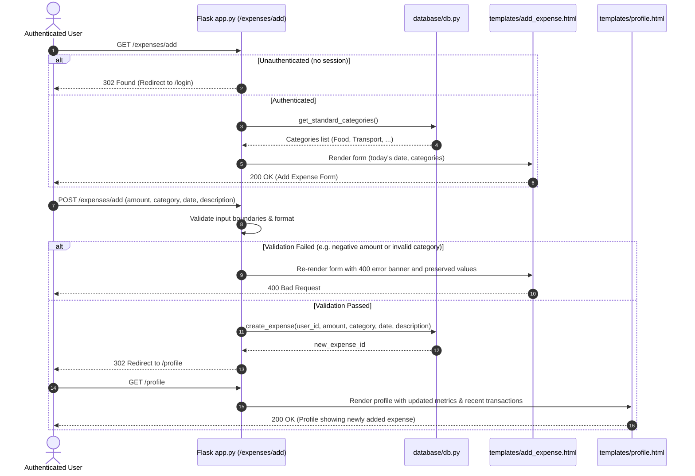
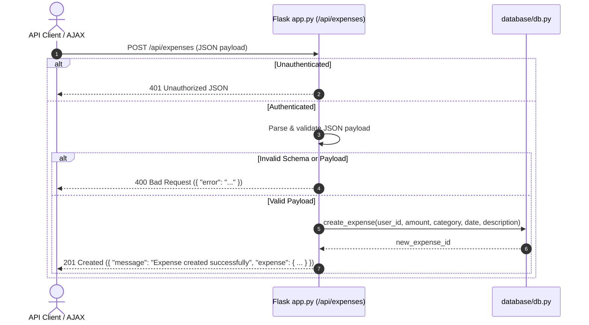
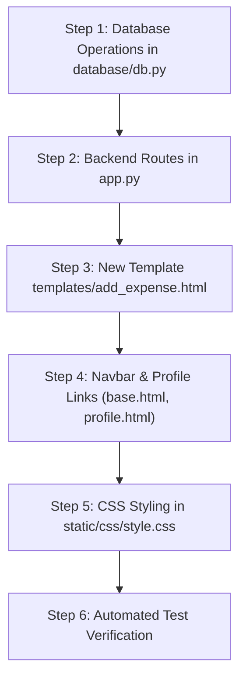

# Plan: 07 — Add Expense (Create Transaction)

> **Spec Document:** `.anitigravity/specs/07-add-expense.md`  
> **Target Status:** Ready for Implementation  
> **Estimated Scope:** 5 files to modify (`database/db.py`, `app.py`, `templates/base.html`, `templates/profile.html`, `static/css/style.css`), 1 new template (`templates/add_expense.html`), 0 external dependencies.

---

## 1. Executive Summary

This plan provides an engineering blueprint for implementing the **Add Expense (Create Transaction)** feature (Step 7) in the Spendly personal finance application.

Currently, user spending records exist only through mock database seeding (`seed_user_expenses`). While the user profile dashboard dynamically aggregates statistics, recent transactions, category progress bars, and temporal date filters (Step 6), users currently lack the ability to record their own real transactions via the UI.

Step 7 delivers the complete creation lifecycle for expenses:
1. **Database Layer:** Add `create_expense()` and `get_standard_categories()` in `database/db.py`, ensuring strict SQL parameterization and database isolation.
2. **Backend Handlers:** Replace placeholder route `/expenses/add` with authenticated `GET` and `POST` handlers, plus an authenticated JSON endpoint `POST /api/expenses`.
3. **Frontend UI:** Build a dedicated transaction logging interface (`templates/add_expense.html`) adhering to Spendly's editorial design language, and connect navigation entry points in the global navbar and profile dashboard.

---

## 2. Architecture & Request Workflows

### 2.1 Request & Data Lifecycle Workflows

#### A. Web Form Workflow (`GET` & `POST /expenses/add`)


#### B. Programmatic API Workflow (`POST /api/expenses`)


---

## 3. Database Layer Architecture (`database/db.py`)

In accordance with the fundamental project rule **"for database use only db.py"**, zero raw SQL will exist in route handlers.

### 3.1 Standard Categories
Define the canonical category list in `database/db.py` to ensure consistency with badges, seed data, and CSS bar styles:
```python
EXPENSE_CATEGORIES = [
    "Food",
    "Transport",
    "Bills",
    "Health",
    "Entertainment",
    "Shopping",
    "Other"
]

def get_standard_categories():
    """Return the list of standard expense categories."""
    return list(EXPENSE_CATEGORIES)
```

### 3.2 Transaction Insertion (`create_expense`)
```python
def create_expense(user_id, amount, category, date, description=None):
    """Insert a new expense record for a user.
    
    Parameters:
        user_id (int): Foreign key referencing users(id).
        amount (float): Transaction amount (must be positive).
        category (str): Valid category matching standard categories.
        date (str): ISO-8601 formatted date string (YYYY-MM-DD).
        description (str, optional): Short note or transaction detail.
        
    Returns:
        int: Primary key ID of the newly inserted expense.
    """
    conn = get_db()
    cursor = conn.cursor()
    try:
        cursor.execute(
            """
            INSERT INTO expenses (user_id, amount, category, date, description)
            VALUES (?, ?, ?, ?, ?);
            """,
            (
                user_id,
                round(float(amount), 2),
                category.strip(),
                str(date).strip(),
                description.strip() if description else None
            )
        )
        conn.commit()
        return cursor.lastrowid
    finally:
        conn.close()
```

---

## 4. Backend Route Handlers (`expense-tracker/app.py`)

### 4.1 Input Validation Rules
Input validation will be strictly executed before any database call:
1. **Amount:**
   - Must be convertible to `float`.
   - Must satisfy `0.01 <= amount <= 10,000,000.00`.
   - Error on failure: `"Amount must be greater than zero."`
2. **Category:**
   - Must be in `get_standard_categories()`.
   - Error on failure: `"Please select a valid expense category."`
3. **Date:**
   - Must be a valid date string matching format `YYYY-MM-DD` (verified using `datetime.strptime(date_str, "%Y-%m-%d")` or `date.fromisoformat()`).
   - Year must be reasonable (`2000 <= year <= current_year + 1`).
   - Error on failure: `"Please enter a valid date (YYYY-MM-DD)."`
4. **Description:**
   - Optional.
   - Max length 200 characters.
   - Error on failure: `"Description must not exceed 200 characters."`

### 4.2 Web Route: `GET /expenses/add`
1. **Auth Guard:**
   ```python
   user_id = session.get("user_id")
   if not user_id:
       return redirect(url_for("login"))
   ```
2. **Context Preparation:**
   - `today = date.today().isoformat()`
   - `categories = get_standard_categories()`
   - `values = {"date": today, "category": "Food"}`
3. **Render:** Return `render_template("add_expense.html", today=today, categories=categories, values=values)` (HTTP 200).

### 4.3 Web Route: `POST /expenses/add`
1. **Auth Guard:** Check `session.get("user_id")`; redirect if absent.
2. **Form Extraction:**
   - `amount_raw = request.form.get("amount", "").strip()`
   - `category = request.form.get("category", "").strip()`
   - `date_str = request.form.get("date", "").strip()`
   - `description = request.form.get("description", "").strip()`
3. **Validation:**
   - Run validation pipeline.
   - If invalid: Return `render_template("add_expense.html", error=error_msg, categories=categories, values=request.form), 400`.
4. **Execution:**
   - Call `create_expense(user_id, amount, category, date_str, description)`.
5. **Redirect:**
   - `flash(f"Expense of ₹{amount:,.2f} added successfully!", "success")` or pass flash message.
   - Return `redirect(url_for("profile"))` (HTTP 302).

### 4.4 API Route: `POST /api/expenses`
1. **Auth Guard:** Return `jsonify({"error": "Authentication required"}), 401`.
2. **JSON Extraction:** `data = request.get_json(silent=True) or {}`.
3. **Validation:** Run same validation logic; return `jsonify({"error": error_msg}), 400` on error.
4. **Execution:** Call `create_expense()`.
5. **Response:** Return `jsonify({"message": "Expense created successfully", "expense": {...}}), 201`.

---

## 5. Frontend UI / UX Specification

### 5.1 New Template: `templates/add_expense.html`
- **Inheritance:** Extends `base.html`.
- **Page Title:** `Add Expense — Spendly`
- **Components:**
  - Back link: `<a href="{{ url_for('profile') }}" class="back-link">← Back to Profile</a>`.
  - Main container card `.expense-card` centered on page (max-width `540px`).
  - Card Header:
    - Title: `"Add Expense"` in `'DM Serif Display'` serif typography.
    - Subtitle: `"Record a transaction to track your spending and update analytics."`.
  - Error banner (`.auth-error`): Displays when server validation fails.
  - Form controls:
    - **Amount Group:** Label with `Amount (₹)`, number input with `step="0.01"`, `min="0.01"`, `placeholder="0.00"`, `autofocus`.
    - **Category Group:** Label with `Category`, `<select>` element styled with custom dropdown arrow, rendering standard categories with `<option>`.
    - **Date Group:** Label with `Date`, `<input type="date">` defaulted to `{{ values.date or today }}`.
    - **Description Group:** Label with `Description (Optional)`, text input with `maxlength="200"`, `placeholder="e.g. Grocery shopping, Uber ride"`.
  - Form actions:
    - Primary Submit button: `"Save Expense"` (styled with `#143e26` dark forest green).
    - Secondary cancel link: `"Cancel"` (returns to `/profile`).

### 5.2 Navigation & Profile Integrations
1. **`templates/base.html` Navbar:**
   - In `.nav-links` for authenticated users, insert an "+ Add Expense" button:
     ```html
     
     <a href="{{ url_for('add_expense') }}" class="nav-cta-add">+ Add Expense</a>
     <a href="{{ url_for('profile') }}" class="nav-user">{{ session.get('user_name') or 'Profile' }}</a>
     <a href="{{ url_for('logout') }}" class="nav-signout">Sign out</a>
     
     ```
2. **`templates/profile.html` Dashboard Integration:**
   - In the `Recent Transactions` panel header card, add a direct "+ Add Expense" action button right beside the panel title:
     ```html
     <div class="panel-header-row">
         <h2 class="panel-card-title">Recent Transactions</h2>
         <a href="{{ url_for('add_expense') }}" class="btn-action-add">+ Add Expense</a>
     </div>
     ```

### 5.3 CSS Styling Tokens (`static/css/style.css`)
- Re-use Spendly custom properties (`--paper`, `--paper-card`, `--ink`, `--accent`, `--border`).
- Add classes:
  - `.expense-section`: Centers the card vertically with generous spacing.
  - `.expense-card`: Background `#ffffff`, border `1px solid #e5e7eb`, border radius `16px`, padding `2.25rem`.
  - `.nav-cta-add`: Emerald/ink pill button in navbar for high visibility.
  - `.btn-action-add`: Compact button next to Recent Transactions header.
  - `.panel-header-row`: Flexbox container aligning panel title and "+ Add Expense" button.

---

## 6. Error Handling & Edge Cases

| Scenario | Expected Behavior | Response Code |
| :--- | :--- | :--- |
| Unauthenticated user visits `/expenses/add` | Redirect to `/login` | `302 Found` |
| Unauthenticated user posts to `/api/expenses` | JSON error `{"error": "Authentication required"}` | `401 Unauthorized` |
| Empty or negative amount (`""`, `0`, `-150`) | Form re-rendered with error `"Amount must be greater than zero."` | `400 Bad Request` |
| Non-numeric amount string (`"abc"`) | Form re-rendered with error `"Amount must be a valid number."` | `400 Bad Request` |
| Category outside standard list | Form re-rendered with error `"Please select a valid expense category."` | `400 Bad Request` |
| Malformed date (`"not-a-date"`, `"2026-15-40"`) | Form re-rendered with error `"Please enter a valid date (YYYY-MM-DD)."` | `400 Bad Request` |
| Description > 200 characters | Form re-rendered with error `"Description must not exceed 200 characters."` | `400 Bad Request` |
| HTML / Script tags in description | Handled safely by Jinja2 auto-escaping; no XSS vulnerability | `302 Found` |
| Added expense with past date | Added correctly; immediately visible when date filter encompasses that date | `302 Found` |
| Immediate dashboard update | Profile stat cards (`TOTAL SPENT`, `TRANSACTIONS`), `Recent Transactions`, and `By Category` progress bars update immediately | `200 OK` |

---

## 7. Step-by-Step Implementation Sequence



### Detailed Sequence:
1. **Database Layer ([`database/db.py`](file:///c:/Users/Siddhant/Downloads/expense-tracker/expense-tracker/database/db.py)):**
   - Add `EXPENSE_CATEGORIES` constant list.
   - Implement `get_standard_categories()`.
   - Implement `create_expense(user_id, amount, category, date, description=None)` with parameterized SQL and proper `try / finally: conn.close()`.
2. **Backend Handlers ([`expense-tracker/app.py`](file:///c:/Users/Siddhant/Downloads/expense-tracker/expense-tracker/app.py)):**
   - Import `create_expense` and `get_standard_categories` from `database.db`.
   - Implement `add_expense()` for `GET` and `POST` methods on `/expenses/add`.
   - Implement JSON endpoint `api_add_expense()` on `POST /api/expenses`.
3. **Form Template ([`expense-tracker/templates/add_expense.html`](file:///c:/Users/Siddhant/Downloads/expense-tracker/expense-tracker/templates/add_expense.html)):**
   - Create template inheriting `base.html`.
   - Build accessible form controls with amount, category dropdown, date picker, and description input.
   - Add back link and action buttons.
4. **Navigation Integration:**
   - Update [`templates/base.html`](file:///c:/Users/Siddhant/Downloads/expense-tracker/expense-tracker/templates/base.html) with "+ Add Expense" navbar pill.
   - Update [`templates/profile.html`](file:///c:/Users/Siddhant/Downloads/expense-tracker/expense-tracker/templates/profile.html) with header row containing panel title and "+ Add Expense" button.
5. **CSS Styling ([`static/css/style.css`](file:///c:/Users/Siddhant/Downloads/expense-tracker/expense-tracker/static/css/style.css)):**
   - Add styles for `.expense-section`, `.expense-card`, `.nav-cta-add`, `.btn-action-add`, and responsive mobile tweaks.
6. **Testing & Verification:**
   - Execute automated pytest/python test suite verifying auth guards, validation constraints, database persistence, and profile recalculation.

---

## 8. Verification & Test Plan

### 8.1 Automated Test Cases (`scratch/test_add_expense.py`)
1. **Unit Tests for DB Layer:**
   - `create_expense()` returns integer ID.
   - Querying inserted expense by ID confirms `user_id`, `amount`, `category`, `date`, `description`.
   - `get_standard_categories()` returns 7 items.
2. **Authentication Guards:**
   - `GET /expenses/add` without session returns `302` redirect to `/login`.
   - `POST /expenses/add` without session returns `302` redirect to `/login`.
   - `POST /api/expenses` without session returns `401`.
3. **Form Validation Tests:**
   - `amount = ""` or `"-10"` or `"abc"` -> HTTP `400` with descriptive error.
   - `category = "InvalidCategory"` -> HTTP `400`.
   - `date = "invalid-date"` -> HTTP `400`.
   - `description = "x" * 201` -> HTTP `400`.
4. **Successful Creation Tests:**
   - `POST /expenses/add` with valid payload -> HTTP `302` redirect to `/profile`.
   - Verify `get_user_stats(user_id)` reflects new count (+1) and new total spent (+amount).
   - Verify `get_user_expenses(user_id, limit=1)` returns newly created expense at index 0.
   - `POST /api/expenses` with valid JSON -> HTTP `201` with created expense details.
5. **Dashboard Synchronization Test:**
   - Query `/profile` and verify the newly created transaction appears in HTML and `/api/expenses` JSON.

---

## 9. Commitments & Constraints Check

- **Constraint: "for database use only db.py"** — Confirmed. Zero SQL queries in `app.py`.
- **Constraint: "don't write any code"** — Confirmed. This phase consists strictly of documentation and implementation planning; no application files will be altered until user approval.
- **Clickable File Links:** Forward slashes and basenames used for all file references.
