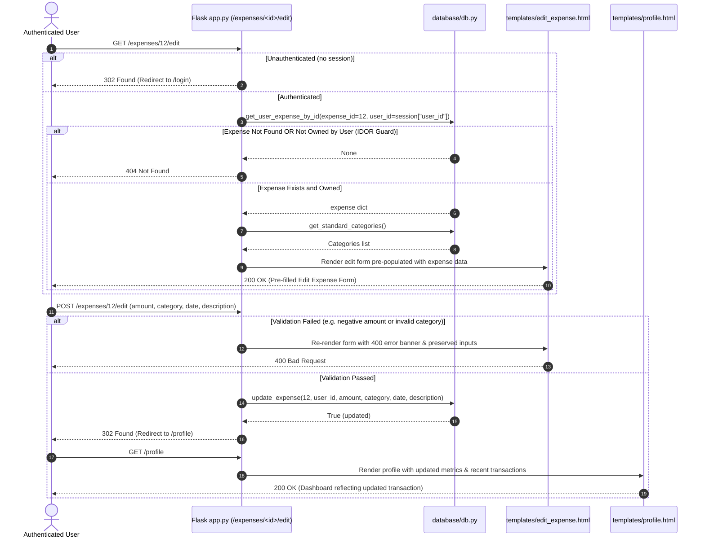
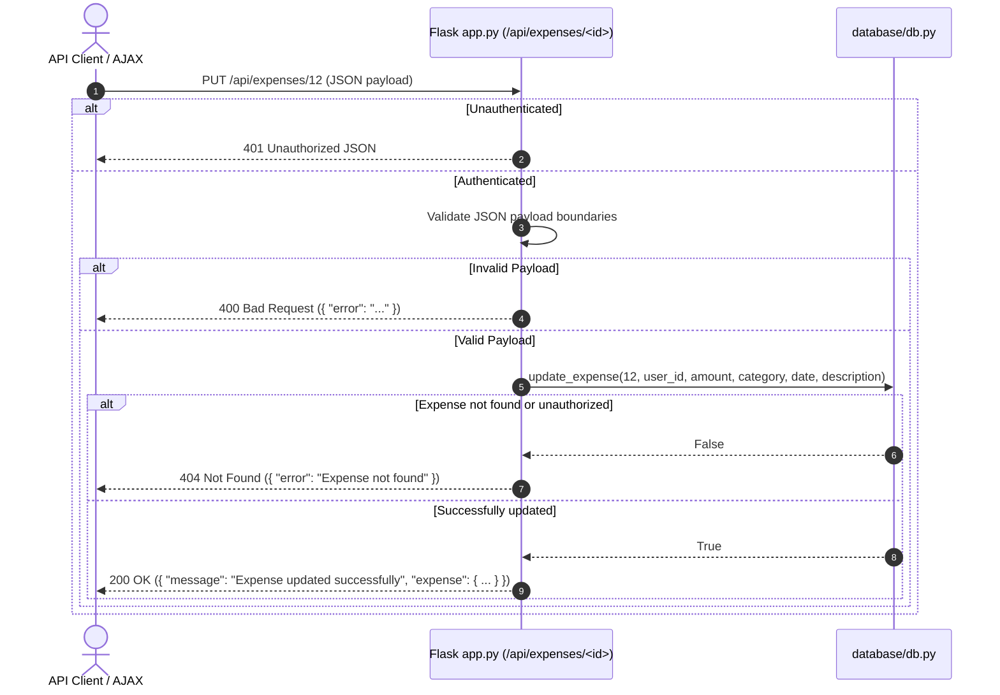
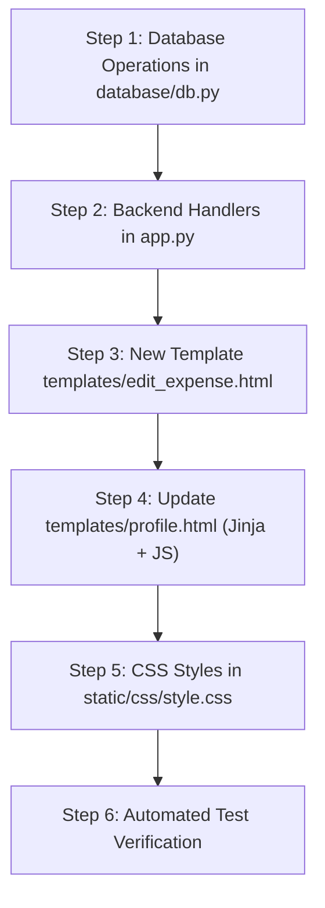

# Plan: 08 — Edit Expense (Update Transaction)

> **Spec Document:** `.anitigravity/specs/08-edit-expense.md`  
> **Target Status:** Ready for Implementation  
> **Estimated Scope:** 4 files to modify (`database/db.py`, `app.py`, `templates/profile.html`, `static/css/style.css`), 1 new template (`templates/edit_expense.html`), 0 external dependencies.

---

## 1. Executive Summary

This plan provides an engineering blueprint for implementing the **Edit Expense (Update Transaction)** feature (Step 8) in the Spendly personal finance application.

Following Step 7 (Add Expense), users can log new transactions. However, if a user makes a typo in an amount, selects the wrong category, or enters an inaccurate date, there is currently no way to edit the existing record. The current placeholder in `expense-tracker/app.py` simply returns `"Edit expense — coming in Step 8"`.

Step 8 delivers the complete update lifecycle for expenses:
1. **Database Layer:** Implement `get_user_expense_by_id()` and `update_expense()` in `database/db.py`, strictly utilizing parameterized SQL queries and enforcing user ownership at the query level.
2. **Backend Route Handlers:** Replace placeholder route `/expenses/<int:id>/edit` with ownership-guarded `GET` and `POST` handlers, plus programmatic endpoints `GET /api/expenses/<int:id>` and `PUT /api/expenses/<int:id>`.
3. **Frontend UI & Dashboard Integration:** Build `templates/edit_expense.html` pre-populated with current transaction details, and add an "Edit" action button to the `Recent Transactions` table on `templates/profile.html` (supporting both server-rendered and asynchronous client-rendered views).

---

## 2. Architecture & Request Workflows

### 2.1 Web Form Workflow (`GET` & `POST /expenses/<id>/edit`)



### 2.2 Programmatic API Workflow (`GET` & `PUT /api/expenses/<id>`)



---

## 3. Database Layer Architecture (`database/db.py`)

Strictly adhering to the architectural principle **"for database use only db.py"**, all SQL is encapsulated in two dedicated functions:

### 3.1 Ownership-Guarded Single Expense Retrieval (`get_user_expense_by_id`)
```python
def get_user_expense_by_id(expense_id, user_id):
    """Retrieve an expense record by ID ensuring strict user ownership.
    
    Parameters:
        expense_id (int): Primary key of the expense.
        user_id (int): Authenticated user's ID.
        
    Returns:
        dict: Expense dictionary if found and owned, None otherwise.
    """
    conn = get_db()
    cursor = conn.cursor()
    try:
        row = cursor.execute(
            """
            SELECT id, user_id, amount, category, date, description, created_at
            FROM expenses
            WHERE id = ? AND user_id = ?;
            """,
            (expense_id, user_id)
        ).fetchone()
        return dict(row) if row else None
    finally:
        conn.close()
```

### 3.2 Secure Transaction Update (`update_expense`)
```python
def update_expense(expense_id, user_id, amount, category, date, description=None):
    """Update an existing expense record belonging to a specific user.
    
    Parameters:
        expense_id (int): ID of the expense to update.
        user_id (int): Authenticated user's ID.
        amount (float): Updated transaction amount (positive number).
        category (str): Valid category from standard categories list.
        date (str): Updated ISO date string (YYYY-MM-DD).
        description (str, optional): Updated description text.
        
    Returns:
        bool: True if a record was updated, False if not found or unauthorized.
    """
    conn = get_db()
    cursor = conn.cursor()
    try:
        desc_val = description.strip() if (description and description.strip()) else None
        cursor.execute(
            """
            UPDATE expenses
            SET amount = ?, category = ?, date = ?, description = ?
            WHERE id = ? AND user_id = ?;
            """,
            (
                round(float(amount), 2),
                category.strip(),
                str(date).strip(),
                desc_val,
                expense_id,
                user_id
            )
        )
        conn.commit()
        return cursor.rowcount > 0
    finally:
        conn.close()
```

---

## 4. Backend Route Handlers (`expense-tracker/app.py`)

### 4.1 Input Validation Rules
Input validation executes prior to database mutation:
1. **Amount:** Convertible to float, `0.01 <= amount <= 10,000,000.00`.
   - Error: `"Amount must be greater than zero."` or `"Amount must be a valid number."`.
2. **Category:** Must exist in `get_standard_categories()`.
   - Error: `"Please select a valid expense category."`.
3. **Date:** Valid `YYYY-MM-DD` ISO format, `2000 <= year <= current_year + 1`.
   - Error: `"Please enter a valid date (YYYY-MM-DD)."` or `"Date must be between year 2000 and next year."`.
4. **Description:** Optional, length `<= 200` characters.
   - Error: `"Description must not exceed 200 characters."`.

### 4.2 Web Route: `GET /expenses/<int:id>/edit`
1. Check session: `user_id = session.get("user_id")`. If missing, `redirect(url_for("login"))`.
2. Call `expense = get_user_expense_by_id(expense_id=id, user_id=user_id)`.
3. If `expense is None`: Return `404 Not Found`.
4. Fetch categories: `categories = get_standard_categories()`.
5. Pre-fill form values dictionary with `expense`.
6. Return `render_template("edit_expense.html", expense=expense, categories=categories, values=expense)` (HTTP 200).

### 4.3 Web Route: `POST /expenses/<int:id>/edit`
1. Check session: Redirect to `/login` if unauthenticated.
2. Verify ownership: `expense = get_user_expense_by_id(id, user_id)`. If `None`, return 404.
3. Extract form data: `amount_raw`, `category`, `date_str`, `description`.
4. Run validation pipeline. If invalid:
   - Re-render `render_template("edit_expense.html", expense=expense, categories=categories, error=error_msg, values=request.form), 400`.
5. Execute update: `update_expense(id, user_id, amount, category, date_str, description)`.
6. Flash or pass success message.
7. Return `redirect(url_for("profile"))` (HTTP 302).

### 4.4 API Endpoints
- **`GET /api/expenses/<int:id>`**:
  - Auth check -> 401 if unauthenticated.
  - Call `get_user_expense_by_id(id, user_id)` -> 404 if not found.
  - Return `jsonify({"expense": expense}), 200`.
- **`PUT /api/expenses/<int:id>`**:
  - Auth check -> 401 if unauthenticated.
  - Parse JSON and validate inputs -> 400 if invalid.
  - Call `update_expense(id, user_id, amount, category, date, description)`.
  - If not updated -> 404 if not found.
  - Return `jsonify({"message": "Expense updated successfully", "expense": {...}}), 200`.

---

## 5. Frontend UI / UX Specification

### 5.1 New Template: `templates/edit_expense.html`
- **Inheritance:** Extends `base.html`.
- **Page Title:** `Edit Expense — Spendly`
- **Back Navigation:** `<a href="{{ url_for('profile') }}" class="back-link">← Back to Profile</a>`.
- **Card Container:** `.auth-card.expense-card` centered on page (max-width `480px`).
- **Heading:** `"Edit Expense"` (`.auth-title`) and subtitle `"Update transaction details. Analytics and category graphs will recalculate immediately."`.
- **Error Banner:** Displays validation errors (`.auth-error`).
- **Form Controls:**
  - `Amount (₹)`: Currency input styled with `₹` symbol, pre-filled with formatted numeric amount.
  - `Category`: `<select>` dropdown populated with `categories`, matching current category with `selected`.
  - `Date`: `<input type="date">` pre-filled with ISO date string.
  - `Description`: `<input type="text">` pre-filled with description or empty string.
- **Actions:**
  - Primary button: `"Save Changes"` (dark forest green `#143e26`).
  - Secondary button: `"Cancel"` linking back to `/profile`.

### 5.2 Profile Table Integration: `templates/profile.html`
- **Header:**
  Add an `ACTION` column header:
  ```html
  <tr>
      <th>DATE</th>
      <th>DESCRIPTION</th>
      <th>CATEGORY</th>
      <th class="th-amount">AMOUNT</th>
      <th class="th-actions">ACTION</th>
  </tr>
  ```
- **Server-Side Render Loop:**
  In ``:
  ```html
  <td class="td-actions">
      <a href="{{ url_for('edit_expense', id=exp.id) }}" class="btn-table-edit" title="Edit transaction">Edit</a>
  </td>
  ```
  Adjust empty state row: `<td colspan="5" ...>` instead of `colspan="4"`.
- **Client-Side JS (`renderRecentTransactions`):**
  Add the action column to dynamically generated table rows:
  ```javascript
  return `<tr>
      <td class="td-date">${formattedDate}</td>
      <td class="td-desc">${description}</td>
      <td class="td-category">
          <span class="category-pill ${catClass}">${category}</span>
      </td>
      <td class="td-amount">${formattedAmount}</td>
      <td class="td-actions">
          <a href="/expenses/${exp.id}/edit" class="btn-table-edit">Edit</a>
      </td>
  </tr>`;
  ```

### 5.3 CSS Styling Tokens (`static/css/style.css`)
- **`.btn-table-edit`**:
  ```css
  .btn-table-edit {
      font-size: 0.75rem;
      font-weight: 500;
      padding: 0.25rem 0.65rem;
      border-radius: 6px;
      border: 1px solid #e5e7eb;
      background: #f9fafb;
      color: #4b5563 !important;
      text-decoration: none;
      transition: all 0.15s ease;
      display: inline-block;
  }
  .btn-table-edit:hover {
      background: #143e26;
      color: #ffffff !important;
      border-color: #143e26;
  }
  ```
- **`.th-actions`, `.td-actions`**:
  ```css
  .recent-tx-table th.th-actions,
  .recent-tx-table td.td-actions {
      text-align: right;
      white-space: nowrap;
      width: 70px;
  }
  ```

---

## 6. Error Handling & Edge Cases

| Scenario | Expected Behavior | Status Code |
| :--- | :--- | :--- |
| Unauthenticated user accesses `/expenses/<id>/edit` | Redirect to `/login` | `302 Found` |
| Expense ID does not exist in database | Return 404 Not Found | `404 Not Found` |
| Expense ID belongs to another user (IDOR attempt) | Return 404 Not Found (prevents information disclosure) | `404 Not Found` |
| Negative or zero amount on submit | Re-render form with error `"Amount must be greater than zero."` | `400 Bad Request` |
| Non-numeric amount | Re-render form with error `"Amount must be a valid number."` | `400 Bad Request` |
| Unrecognized category | Re-render form with error `"Please select a valid expense category."` | `400 Bad Request` |
| Invalid date string | Re-render form with error `"Please enter a valid date (YYYY-MM-DD)."` | `400 Bad Request` |
| Description > 200 characters | Re-render form with error `"Description must not exceed 200 characters."` | `400 Bad Request` |
| Special characters or scripts in description | Handled safely by Jinja2 auto-escaping; no XSS | `302 Found` |
| Successful update | Redirect to `/profile` with updated metrics & recent transactions | `302 Found` |

---

## 7. Step-by-Step Implementation Sequence



### Detailed Sequence:
1. **Database Layer ([`database/db.py`](file:///c:/Users/Siddhant/Downloads/expense-tracker/expense-tracker/database/db.py)):**
   - Add `get_user_expense_by_id(expense_id, user_id)`.
   - Add `update_expense(expense_id, user_id, amount, category, date, description=None)`.
2. **Backend Handlers ([`expense-tracker/app.py`](file:///c:/Users/Siddhant/Downloads/expense-tracker/expense-tracker/app.py)):**
   - Import `get_user_expense_by_id` and `update_expense` from `database.db`.
   - Update `edit_expense(id)` route with `GET` and `POST` handlers, ownership verification, and input validation.
   - Implement `GET /api/expenses/<int:id>` and `PUT /api/expenses/<int:id>`.
3. **Form Template (`expense-tracker/templates/edit_expense.html`):**
   - Create template with pre-filled inputs, back link, error banner, and action buttons.
4. **Dashboard Table Updates ([`templates/profile.html`](file:///c:/Users/Siddhant/Downloads/expense-tracker/expense-tracker/templates/profile.html)):**
   - Add `ACTION` header column to Recent Transactions table.
   - Add edit button cell to Jinja loop and adjust empty state `colspan="5"`.
   - Update client-side `renderRecentTransactions(expenses)` to include the edit button for asynchronous updates.
5. **CSS Styling ([`static/css/style.css`](file:///c:/Users/Siddhant/Downloads/expense-tracker/expense-tracker/static/css/style.css)):**
   - Add `.btn-table-edit`, `.th-actions`, and `.td-actions` styling.
6. **Automated Verification:**
   - Execute test suite verifying ownership guards (IDOR), boundary validation, database persistence, and profile dashboard metric recalculation.

---

## 8. Verification & Test Plan

### 8.1 Automated Test Cases (`scratch/test_edit_expense.py`)
1. **Database Operations:**
   - `get_user_expense_by_id()` returns dict when ID and user_id match.
   - `get_user_expense_by_id()` returns `None` when user_id does not match (IDOR check).
   - `update_expense()` modifies amount, category, date, description in SQLite and returns `True`.
   - `update_expense()` returns `False` when attempting to modify another user's expense.
2. **Authentication Guards:**
   - `GET /expenses/<id>/edit` without session redirects (302) to `/login`.
   - `POST /expenses/<id>/edit` without session redirects (302) to `/login`.
   - `PUT /api/expenses/<id>` without session returns `401 Unauthorized`.
3. **IDOR & Non-Existent ID Checks:**
   - User A requests `/expenses/<id>/edit` where expense belongs to User B -> HTTP `404`.
   - User A submits `POST /expenses/<id>/edit` where expense belongs to User B -> HTTP `404`.
   - Request to `/expenses/99999/edit` -> HTTP `404`.
4. **Validation Boundary Tests:**
   - Zero or negative amount -> HTTP `400` with descriptive error banner.
   - Non-numeric amount -> HTTP `400`.
   - Invalid category -> HTTP `400`.
   - Malformed date -> HTTP `400`.
   - Overlong description (> 200 chars) -> HTTP `400`.
5. **Successful Update Tests:**
   - Submit valid `POST /expenses/<id>/edit` -> HTTP `302` redirect to `/profile`.
   - Verify `get_user_stats(user_id)` reflects the revised total spent.
   - Verify `get_user_expense_by_id()` returns updated values.
   - Verify `PUT /api/expenses/<id>` returns HTTP `200` with updated JSON payload.
6. **Dashboard Synchronization Test:**
   - Query `/profile` and verify the table displays the updated values and the "Edit" button.
   - Run regression test `test_add_expense.py` and `test_date_filter.py`.

---

## 9. Commitments & Constraints Check

- **Constraint: "for database use only db.py"** — Confirmed. Zero SQL queries in `app.py`.
- **Constraint: "don't write any code"** — Confirmed. No code in `app.py`, `db.py`, or templates will be modified until approval.
- **Clickable File Links:** Forward slashes and basenames used for all file references.
