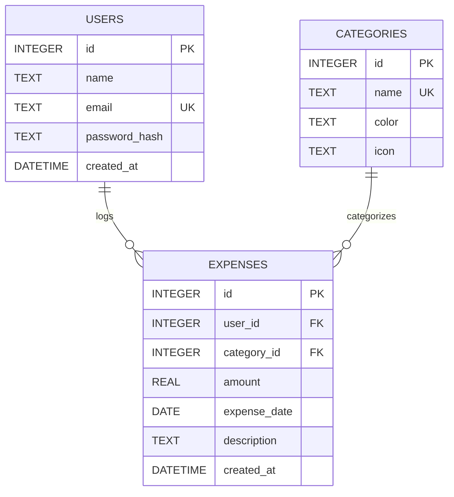
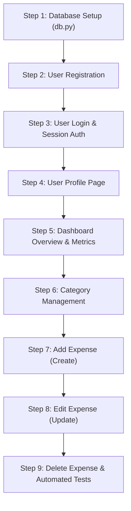

# Spendly (Expense Tracker) — Technical Architecture & Codebase Guide

> Comprehensive documentation and structural analysis of the **Spendly** personal finance and expense tracking application.

---

## 1. Executive Project Overview

**Spendly** is a lightweight, educational personal finance web application built in Python using Flask and SQLite. The application is organized as a step-by-step modular project designed to guide developers from initial database scaffolding and user authentication through complete CRUD (Create, Read, Update, Delete) expense management and analytical reporting.

### Core Technology Stack

- **Backend Framework:** [Flask 3.1.3](https://flask.palletsprojects.com/) (WSGI web application)
- **Security & Utilities:** [Werkzeug 3.1.6](https://palletsprojects.com/p/werkzeug/) (Password hashing, routing helpers)
- **Templating Engine:** [Jinja2 3.1.6](https://jinja.palletsprojects.com/) (Template inheritance, macros, safe rendering)
- **Database Engine:** SQLite 3 (Lightweight relational database via Python's standard `sqlite3` library)
- **Frontend Architecture:** Vanilla CSS3 (Custom design system with CSS custom properties) and Zero-Dependency Vanilla JavaScript
- **Testing Suite:** [pytest 8.3.5](https://docs.pytest.org/) and [pytest-flask 1.3.0](https://pytest-flask.readthedocs.io/)

---

## 2. Directory Tree & File Inventory

```
expense-tracker/
├── .gitignore                          # Repository-level ignore rules (venv, db, caches, OS metadata)
├── ANTIGRAVITY.md                      # Codebase guide and architecture documentation
└── expense-tracker/                    # Core application directory
    ├── app.py                          # Flask application entry point and route definitions
    ├── requirements.txt                # Production and development dependencies
    ├── .gitignore                      # Sub-directory specific git ignore file
    ├── database/                       # Database initialization and management modules
    │   ├── __init__.py                 # Package marker for database module
    │   └── db.py                       # DB connection, schema creation, and seeding scaffolding
    ├── static/                         # Static assets served by Flask
    │   ├── css/
    │   │   ├── style.css               # Core design tokens, global layout, auth forms, legal pages, footer
    │   │   └── landing.css             # Hero section layout, mockup visualizer, and video modal styles
    │   └── js/
    │       └── main.js                 # Global client-side JavaScript entry point
    └── templates/                      # Jinja2 HTML templates
        ├── base.html                   # Master layout with navbar, footer, typography, and script slots
        ├── landing.html                # Product landing page with hero, interactive mockup, video modal, and CTA
        ├── login.html                  # User authentication / sign-in form
        ├── register.html               # New user onboarding / registration form
        ├── terms.html                  # Terms & Conditions legal page
        └── privacy.html                # Privacy Policy disclosure page
```

---

## 3. Application Routing & Endpoints

All routing is centralized in [`expense-tracker/app.py`](file:///c:/Users/Siddhant/Downloads/expense-tracker/expense-tracker/app.py). The server runs with `debug=True` on port `5001`.

| Method | Endpoint | Template / Handler | Status | Description |
| :--- | :--- | :--- | :--- | :--- |
| `GET` | `/` | `templates/landing.html` | **Implemented** | Landing page featuring hero banner, interactive mockup, and video modal |
| `GET`, `POST` | `/register` | `templates/register.html` | **Template Ready** | User registration form (POST handler pending Step 2) |
| `GET`, `POST` | `/login` | `templates/login.html` | **Template Ready** | User sign-in form (POST handler pending Step 3) |
| `GET` | `/terms` | `templates/terms.html` | **Implemented** | Legal disclosure: Terms and Conditions |
| `GET` | `/privacy` | `templates/privacy.html` | **Implemented** | Privacy Policy & user data disclosure |
| `GET` | `/logout` | Placeholder String | *Pending (Step 3)* | Ends user session and redirects to login |
| `GET` | `/profile` | Placeholder String | *Pending (Step 4)* | User settings and account summary |
| `GET`, `POST` | `/expenses/add` | Placeholder String | *Pending (Step 7)* | Expense logging form |
| `GET`, `POST` | `/expenses/<id>/edit`| Placeholder String | *Pending (Step 8)* | Form to edit existing transaction |
| `POST` | `/expenses/<id>/delete`| Placeholder String | *Pending (Step 9)*| Deletes an expense by ID |

---

## 4. Database Architecture & Design (`database/db.py`)

The database subsystem in [`expense-tracker/database/db.py`](file:///c:/Users/Siddhant/Downloads/expense-tracker/expense-tracker/database/db.py) defines the relational structure for user authentication and transaction management.

### Essential Methods

1. **`get_db()`**
   - Returns a `sqlite3.Connection` instance.
   - Configures `conn.row_factory = sqlite3.Row` to allow dictionary-like row access (`row['amount']`).
   - Executes `PRAGMA foreign_keys = ON;` to enforce foreign key integrity across tables.
2. **`init_db()`**
   - Executes idempotent `CREATE TABLE IF NOT EXISTS` DDL statements.
3. **`seed_db()`**
   - Injects development sample data for instant local testing.

### Relational Schema Blueprint



---

## 5. Frontend & UI Design System

The application uses an editorial aesthetic characterized by warm parchment backgrounds, deep ink typography, and high-contrast emerald green accents.

### Typography & Color Tokens ([`static/css/style.css`](file:///c:/Users/Siddhant/Downloads/expense-tracker/expense-tracker/static/css/style.css))

- **Display Typeface:** `'DM Serif Display', Georgia, serif` — Used for prominent editorial headlines.
- **Body Typeface:** `'DM Sans', system-ui, sans-serif` — Clean, geometric sans-serif for UI, cards, and data.
- **Color Variables:**
  - `--ink`: `#0f0f0f` (Primary text and high-contrast buttons)
  - `--ink-soft`: `#2d2d2d` (Body copy)
  - `--ink-muted`: `#6b6b6b` (Subtitles and secondary metadata)
  - `--paper`: `#f7f6f3` (Warm neutral page background)
  - `--paper-warm`: `#f0ede6` (Section background fill)
  - `--paper-card`: `#ffffff` (Card component background)
  - `--accent`: `#1a472a` / `#1b8360` (Primary emerald green brand accent)
  - `--accent-light`: `#e8f0eb` / `#e1f6ee` (Pill badges and positive state fills)
  - `--danger`: `#c0392b` / `#e05252` (Error messages and expense alerts)

### Key Frontend Components

1. **Master Layout ([`templates/base.html`](file:///c:/Users/Siddhant/Downloads/expense-tracker/expense-tracker/templates/base.html)):**
   - Sticky navbar containing the Spendly emblem (`◈`), brand title, and quick-action links.
   - Central `<main class="main-content">` injection block (``).
   - Global footer with persistent legal links (`/terms` and `/privacy`) separated by dot dividers.
   - Script injection block (``).

2. **Landing Page Hero & Interactive Mockup ([`templates/landing.html`](file:///c:/Users/Siddhant/Downloads/expense-tracker/expense-tracker/templates/landing.html) & [`static/css/landing.css`](file:///c:/Users/Siddhant/Downloads/expense-tracker/expense-tracker/static/css/landing.css)):**
   - Pill badge: `● Free to use · No credit card needed`.
   - Dual-tone headline: *Track every rupee.* in ink black and *Know where it goes.* in vibrant green.
   - Mockup Window: Displays 3 stat cards (*This month: ₹18,240*, *Budget left: ₹6,760*, *Transactions: 34*) alongside proportional category progress bars (*Food: 76%*, *Travel: 51%*, *Bills: 40%*).

3. **Vanilla JS Video Modal ([`templates/landing.html`](file:///c:/Users/Siddhant/Downloads/expense-tracker/expense-tracker/templates/landing.html)):**
   - Triggered by the `"See how it works"` button.
   - Embeds an autoplaying 16:9 YouTube iframe.
   - Supports closing via the close button (`&times;`), clicking the blurred backdrop overlay, or pressing the <kbd>Esc</kbd> key.
   - Automatically unsets `iframe.src` upon closure to ensure video audio does not persist in the background.

---

## 6. Student Curriculum & Implementation Roadmap

The project is structured into sequential development steps:



- **Step 1 — Database Setup:** Implement `get_db()`, `init_db()`, and schema migrations in `database/db.py`.
- **Step 2 — User Registration:** Handle `POST /register`, validate inputs, and hash passwords using `werkzeug.security.generate_password_hash`.
- **Step 3 — User Authentication:** Handle `POST /login` with `check_password_hash`, manage Flask `session`, and implement `/logout`.
- **Step 4 — Profile Page:** Render account metrics and allow user details updates.
- **Step 5 — Dashboard Metrics:** Query database to aggregate total monthly spending and category distributions.
- **Step 6 — Categories:** Provide CRUD for customizable expense categories.
- **Step 7 — Add Expense:** Build transaction creation form with category selectors and date pickers.
- **Step 8 — Edit Expense:** Allow updating existing transactions with pre-populated values.
- **Step 9 — Delete Expense & Testing:** Complete RESTful deletion and verify flows using `pytest`.

---

## 7. Developer Setup & Execution Guide

### 1. Prerequisites
- Python 3.10+ installed on the host system.

### 2. Environment Activation
From the repository root:
```powershell
# Windows PowerShell virtual environment activation
.\.venv\Scripts\Activate.ps1
```

### 3. Dependency Installation
```powershell
pip install -r expense-tracker\requirements.txt
```

### 4. Running the Development Server
```powershell
cd expense-tracker
python app.py
```
*The application will start on `http://127.0.0.1:5001/` with auto-reload enabled.*

### 5. Running Automated Tests
```powershell
pytest
```

---

## 8. Version Control & Git Configuration

- **Default Branch:** `main`
- **Remote Origin:** `https://github.com/Swujjwal/expendly-.git`
- **Exclusion Policy (`.gitignore`):**
  - Python virtual environments (`.venv/`, `venv/`)
  - SQLite database instances (`*.db`, `*.sqlite3`, `expense_tracker.db`)
  - Bytecode caches (`__pycache__/`, `*.pyc`)
  - OS metadata (`__MACOSX/`, `.DS_Store`)
  - Environment variables (`.env`)

